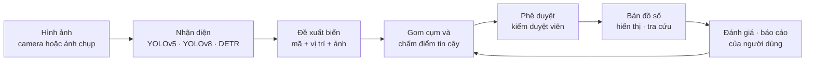

# 01 · Tổng quan

## 1. Đề tài

| Mục | Nội dung |
| --- | --- |
| Tên đề tài | Xây dựng hệ thống hỗ trợ nhận diện và hiển thị biển báo giao thông trên bản đồ số |
| Tên hệ thống | Signa |
| Giảng viên hướng dẫn | TS. Đào Thị Thúy Quỳnh |
| Nhóm | 3 thành viên |
| Thời gian | 16 tuần |

**Nội dung đăng ký:** hệ thống ứng dụng các mô hình học sâu **YOLOv5, YOLOv8 và DETR** để nhận diện biển báo từ hình ảnh; xây dựng **ứng dụng di động, backend và web quản trị** hỗ trợ người dùng **nhận diện, tra cứu, hiển thị biển báo trên bản đồ**, cùng với **quản lý và phê duyệt dữ liệu biển báo**. Dữ liệu lưu trong **MySQL**; **Redis** lưu dữ liệu tạm thời; **MinIO** lưu hình ảnh biển báo.

Mọi quyết định trong bộ tài liệu này phải truy được về nội dung đăng ký trên. Phần nào không có trong đề tài được đánh dấu là **mở rộng**.

## 2. Bài toán

Người tham gia giao thông thường gặp ba khó khăn với biển báo:

1. **Không hiểu biển** — QCVN 41 có hàng trăm mã biển, nhiều biển chỉ khác nhau ở ký hiệu nhỏ hoặc con số.
2. **Không biết trước biển** — chỉ thấy biển khi tới gần; không có nơi nào tra được "đoạn đường phía trước có những biển gì".
3. **Dữ liệu biển không có sẵn** — bản đồ số phổ biến không có lớp biển báo đầy đủ và cập nhật; biển thay đổi theo thời gian.

Đồ án giải quyết bằng một chuỗi khép kín:

| Khó khăn | Hướng giải quyết | Chi tiết |
| --- | --- | --- |
| Không hiểu biển | Nhận diện từ ảnh và tra cứu danh mục biển theo QCVN 41 | [Đặc tả · FR-02, FR-03, FR-08](02-dac-ta-yeu-cau.md#6-yêu-cầu-chức-năng) |
| Chọn mô hình nào để nhận diện | So sánh có hệ thống YOLOv5, YOLOv8, DETR trên cùng dữ liệu; chọn mô hình triển khai theo số liệu | [Thiết kế AI](04-thiet-ke-ai.md) |
| Không biết trước biển | Hiển thị biển đã phê duyệt trên bản đồ số | [Đặc tả · FR-05](02-dac-ta-yeu-cau.md#6-yêu-cầu-chức-năng) |
| Dữ liệu biển không có sẵn | Người dùng đóng góp đề xuất từ kết quả nhận diện; kiểm duyệt viên phê duyệt | [Đặc tả · FR-04, FR-31](02-dac-ta-yeu-cau.md#6-yêu-cầu-chức-năng) |
| Phê duyệt từng đề xuất tốn công | Gom các đề xuất trùng thành một biển ứng viên; chấm điểm tin cậy và gợi ý quyết định để kiểm duyệt viên xử lý nhanh | [ADR-0004](adr/0004-diem-tin-cay-ban-do.md) |
| Biển thay đổi theo thời gian | Người dùng xác nhận đúng/sai và báo cáo; biển bị nghi ngờ quay lại hàng đợi rà soát | [Đặc tả · FR-09, FR-10, FR-22](02-dac-ta-yeu-cau.md#6-yêu-cầu-chức-năng) |

## 3. Đóng góp chính

| # | Đóng góp | Đầu ra để bảo vệ |
| --- | --- | --- |
| C1 | **So sánh YOLOv5, YOLOv8 và DETR** cho biển báo Việt Nam: độ chính xác tổng và theo lớp, biển nhỏ, điều kiện ngày/đêm/mưa, tốc độ, kích thước | Bảng và biểu đồ so sánh; lý do chọn mô hình triển khai |
| C2 | **Nhận diện thời gian thực trên điện thoại**, không cần mạng | Số đo FPS, độ trễ trên thiết bị tham chiếu |
| C3 | **Phê duyệt có trợ giúp**: gom cụm đề xuất và điểm tin cậy giúp giảm số quyết định của kiểm duyệt viên mà vẫn giữ bản đồ chính xác | So sánh với phê duyệt từng đề xuất trên cùng dữ liệu |
| C4 | **Hệ thống hoàn chỉnh**: ứng dụng di động, backend, web quản trị, triển khai bằng Docker | Bản demo luồng ảnh → đề xuất → phê duyệt → bản đồ |

## 4. Tác nhân

| Tác nhân | Mô tả | Kênh |
| --- | --- | --- |
| Khách | Chưa đăng nhập: nhận diện, tra cứu, xem bản đồ | Ứng dụng di động |
| Người dùng | Đã đăng nhập: thêm đề xuất, đánh giá, báo cáo biển | Ứng dụng di động |
| Kiểm duyệt viên | Phê duyệt đề xuất, xử lý báo cáo, sửa biển trên bản đồ | Web quản trị |
| Quản trị viên | Toàn quyền kiểm duyệt viên, thêm quản lý danh mục biển, người dùng và phân quyền | Web quản trị |

## 5. Phạm vi

| Trong phạm vi | Ngoài phạm vi |
| --- | --- |
| Biển cấm, hiệu lệnh, nguy hiểm và cảnh báo, biển phụ (chỉ nhận diện vùng) theo QCVN 41 — danh mục chốt ở [Dữ liệu §2](05-du-lieu.md#2-danh-mục-nhãn) | Biển chỉ dẫn dạng bảng lớn, vạch kẻ đường, đèn tín hiệu |
| Nhận diện từ ảnh tải lên (server, 3 mô hình) và từ camera (trên điện thoại) | Video tải lên server |
| Ứng dụng Android | iOS |
| Thử nghiệm thực địa trên một số tuyến đường do nhóm tự đi | Triển khai cho người dùng thật quy mô lớn |
| **Mở rộng:** cảnh báo giới hạn tốc độ bằng giọng nói | Dẫn đường, đọc chữ trên biển phụ, huấn luyện lại tự động, cập nhật mô hình qua mạng |

## 6. Thành phần hệ thống

| Thành phần | Thư mục dự kiến | Vai trò |
| --- | --- | --- |
| Ứng dụng di động | `mobile/` | Nhận diện trên máy, gửi ảnh nhận diện, bản đồ, tra cứu, đề xuất, đánh giá, báo cáo |
| Backend | `backend/` | Tài khoản, phân quyền, danh mục, biển báo, đề xuất, phê duyệt, đánh giá, báo cáo, lịch sử |
| Dịch vụ nhận diện | `ai/` | Chạy YOLOv5, YOLOv8, DETR cho ảnh tải lên |
| Huấn luyện mô hình | `ai/` | Dữ liệu, huấn luyện, đánh giá, xuất mô hình cho điện thoại |
| Web quản trị | `web-admin/` | Phê duyệt, báo cáo, danh mục, người dùng, lịch sử, thống kê |
| Hạ tầng | `infra/` | Docker Compose: MySQL, Redis, MinIO, nginx |

Kiến trúc chi tiết: [03 · Kiến trúc hệ thống](03-kien-truc.md).

## 7. Phân công

| Thành viên | Mảng chính | Hỗ trợ |
| --- | --- | --- |
| Thành viên 1 | AI và dữ liệu: danh mục nhãn, dữ liệu, huấn luyện và so sánh 3 mô hình | Đánh giá thực địa |
| Thành viên 2 | Backend, dịch vụ nhận diện, web quản trị, hạ tầng | Phục vụ mô hình trên server |
| Thành viên 3 | Ứng dụng di động | Xuất mô hình sang TFLite, đo hiệu năng trên thiết bị |

Ba điểm nối phải chốt trong tuần 1–2: [danh mục nhãn](05-du-lieu.md#2-danh-mục-nhãn), [API nhận diện ảnh](07-api.md), [API đề xuất và bản đồ](07-api.md). Kế hoạch theo tuần: [09 · Hạng mục công việc](09-hang-muc-cong-viec.md).
