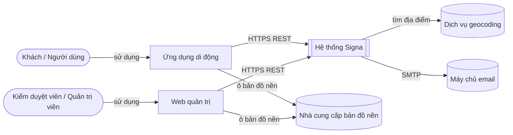
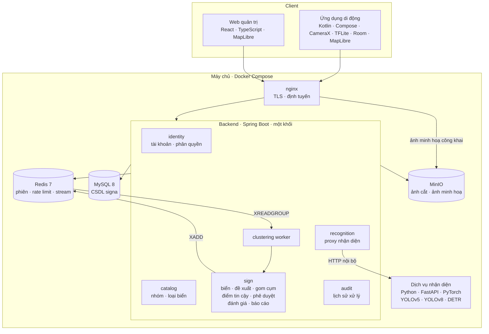
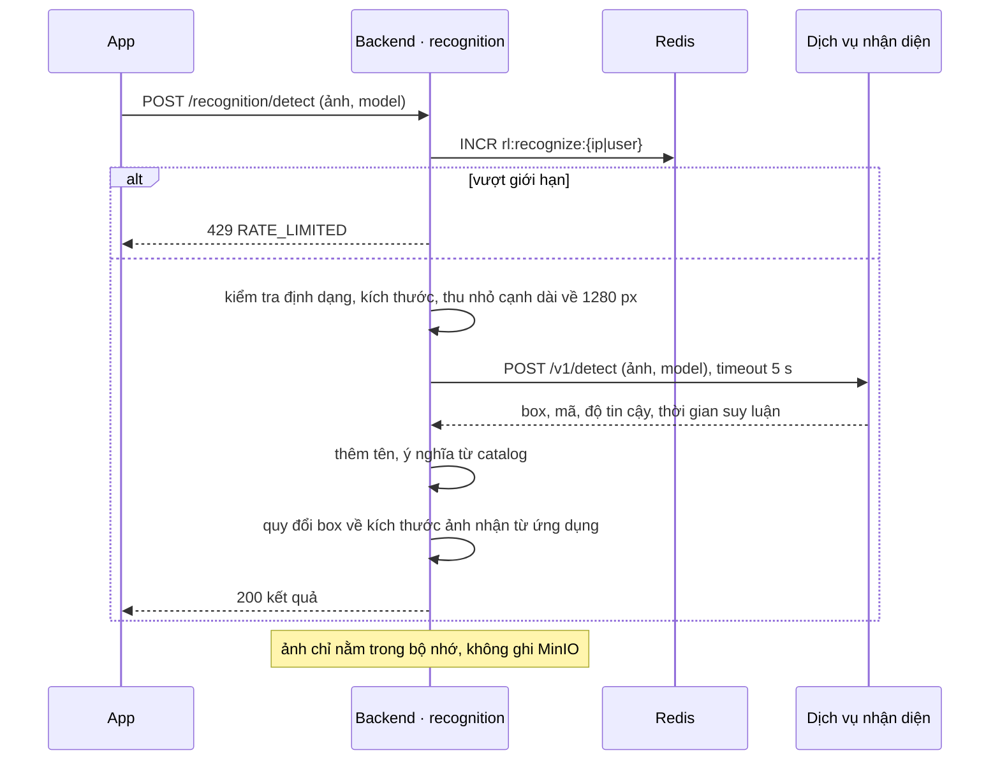
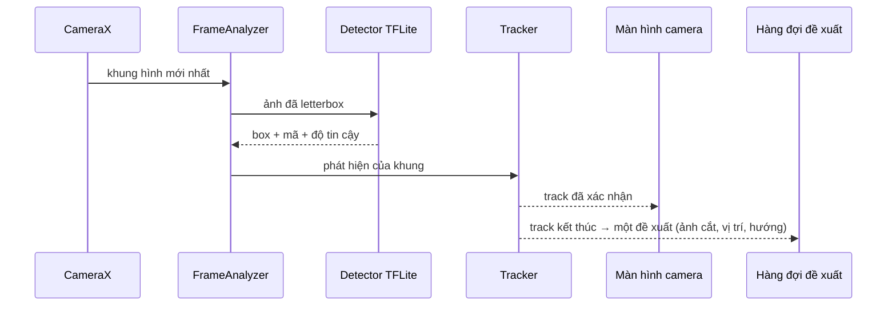
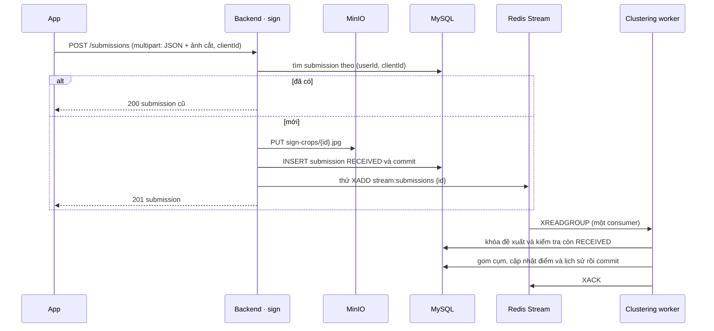
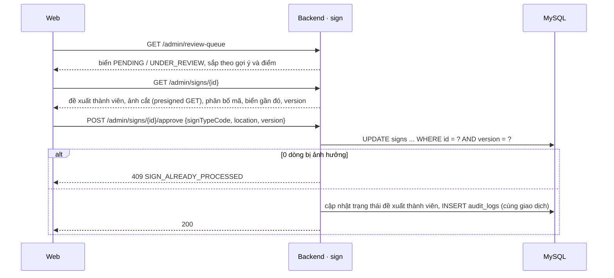
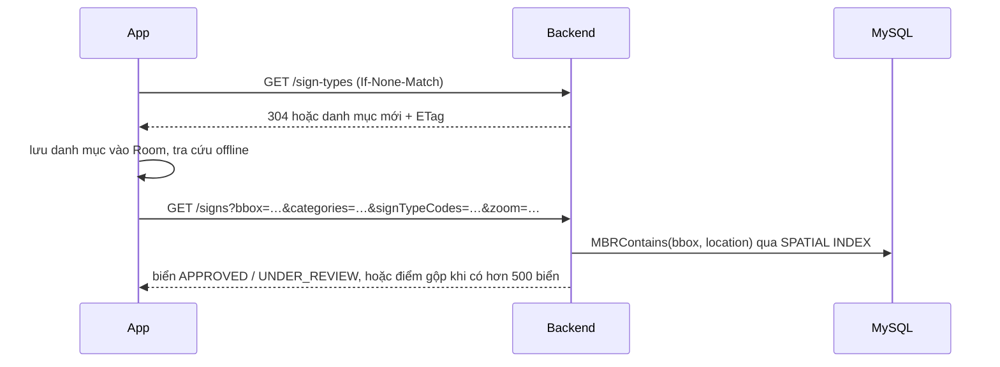
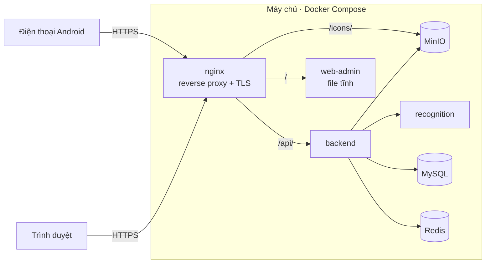

# 03 · Kiến trúc hệ thống

## Mục lục

1. [Yêu cầu chi phối kiến trúc](#1-yêu-cầu-chi-phối-kiến-trúc)
2. [Nguyên tắc](#2-nguyên-tắc)
3. [Sơ đồ ngữ cảnh](#3-sơ-đồ-ngữ-cảnh)
4. [Sơ đồ thành phần](#4-sơ-đồ-thành-phần)
5. [Trách nhiệm từng thành phần](#5-trách-nhiệm-từng-thành-phần)
6. [Luồng xử lý chính](#6-luồng-xử-lý-chính)
7. [Ước lượng tải](#7-ước-lượng-tải)
8. [Triển khai](#8-triển-khai)
9. [Vấn đề xuyên suốt](#9-vấn-đề-xuyên-suốt)
10. [Đánh đổi và điểm cần xem lại](#10-đánh-đổi-và-điểm-cần-xem-lại)

## 1. Yêu cầu chi phối kiến trúc

| Yêu cầu | Hệ quả kiến trúc |
| --- | --- |
| Đề tài bắt buộc YOLOv5, YOLOv8, DETR (AI-02, FR-24) | Một dịch vụ Python riêng nạp cả 3 mô hình; backend Java không chạy mô hình |
| Nhận diện qua camera ≥ 15 FPS, không cần mạng (NFR-01, NFR-08) | Một mô hình nhỏ chạy trên điện thoại bằng TFLite; DETR chỉ chạy trên server |
| Phê duyệt có trợ giúp, không xử lý chồng (FR-20, FR-21, FR-31) | Gom cụm chạy tuần tự qua một hàng đợi; khoá lạc quan khi phê duyệt |
| Lịch sử xử lý biển (FR-23, NFR-11) | Ghi lịch sử tạo biển và thay đổi trạng thái, mã, vị trí trong cùng giao dịch |
| MySQL, Redis, MinIO theo đề tài | MySQL là nguồn dữ liệu chuẩn; Redis cho phiên, giới hạn tần suất, hàng đợi; MinIO cho ảnh |
| Nhóm 3 người, 16 tuần | Backend một khối chia module, không tách microservice ([ADR-0005](adr/0005-backend-mot-khoi-chia-module.md)) |

## 2. Nguyên tắc

| Nguyên tắc | Hệ quả thiết kế |
| --- | --- |
| **Đúng tầm** — chọn kiến trúc nhỏ nhất đáp ứng yêu cầu | Một backend, một dịch vụ nhận diện, một CSDL |
| **AI tách khỏi nghiệp vụ** | Dịch vụ nhận diện không có trạng thái, không ghi CSDL; backend là nơi duy nhất ghi dữ liệu |
| **Một nguồn sự thật cho danh mục nhãn** | `ai/data/labels.yaml` sinh ra dữ liệu huấn luyện, bảng `sign_types` và danh mục đóng gói trong ứng dụng |
| **Gửi ít, lưu ít** | Đề xuất gửi ảnh cắt vùng biển. Ảnh gửi chỉ để nhận diện được xử lý trong bộ nhớ |
| **Truy vết xử lý biển** | Ghi `audit_logs` cùng giao dịch theo phạm vi FR-23 và NFR-11. Lịch sử chỉ cho phép đọc qua API |

## 3. Sơ đồ ngữ cảnh



Nhà cung cấp bản đồ nền và geocoding chốt ở [Đặc tả · Q6](02-dac-ta-yeu-cau.md#11-vấn-đề-cần-làm-rõ).

## 4. Sơ đồ thành phần



## 5. Trách nhiệm từng thành phần

| Thành phần | Trách nhiệm | Dữ liệu sở hữu | Không làm |
| --- | --- | --- | --- |
| Ứng dụng di động | Nhận diện qua camera trên máy, gửi ảnh nhận diện, bản đồ, tra cứu, đề xuất, đánh giá, báo cáo, hàng đợi gửi | Room: danh mục biển, hàng đợi đề xuất, cài đặt | Gom cụm, tính điểm |
| Backend · `identity` | Đăng ký, đăng nhập, phiên, OTP, vai trò, quyền, quản lý người dùng | `users`, `roles`, `permissions`, `role_permissions`; khoá Redis `session:*`, `otp:*` | — |
| Backend · `catalog` | Nhóm biển, loại biển, ảnh minh hoạ, nạp từ `labels.yaml` | `sign_categories`, `sign_types`; bucket `sign-icons` | — |
| Backend · `sign` | Đề xuất, gom cụm, điểm tin cậy, gợi ý, phê duyệt, đánh giá, báo cáo, truy vấn bản đồ, thống kê | `signs`, `sign_code_weights`, `submissions`, `sign_ratings`, `sign_reports`; bucket `sign-crops`, `report-photos` | Chạy mô hình |
| Backend · `recognition` | Kiểm tra ảnh, giới hạn tần suất, gọi dịch vụ nhận diện, bổ sung tên và ý nghĩa biển vào kết quả | Không có | Lưu ảnh gốc |
| Backend · `audit` | Ghi và truy vấn lịch sử xử lý | `audit_logs` | Cho sửa, xoá lịch sử |
| Dịch vụ nhận diện | Nạp YOLOv5, YOLOv8, DETR; nhận ảnh, trả box và mã; công bố thẻ mô hình | Không có (file mô hình đóng gói trong image) | Ghi CSDL, xác thực người dùng |
| Web quản trị | Giao diện cho kiểm duyệt viên và quản trị viên | Không có | Truy cập trực tiếp CSDL, MinIO |

Các module backend chỉ gọi nhau qua interface công khai của module (gói `api`), không truy cập bảng của module khác. Ranh giới này được kiểm tra bằng test kiến trúc (ArchUnit), để sau này tách service được nếu cần.

## 6. Luồng xử lý chính

### 6.1. Nhận diện ảnh trên server — FR-02



Khi người dùng bấm "Gửi lên bản đồ", ứng dụng tự cắt vùng biển từ ảnh trên máy và gửi đề xuất theo §6.3 — ảnh gốc không đi lên server lần nữa.

### 6.2. Nhận diện qua camera trên thiết bị — FR-03



Chi tiết: [Thiết kế AI §5](04-thiet-ke-ai.md#5-nhận-diện-trên-thiết-bị).

### 6.3. Gửi đề xuất và gom cụm — FR-04, FR-20, FR-21



Môi trường demo chạy một bản sao backend với một worker gom cụm. MySQL giữ trạng thái đề xuất. Nếu lỗi ghi Redis sau khi MySQL đã commit, API vẫn trả `201`. Worker quét lại các đề xuất `RECEIVED` khi khởi động và định kỳ. Mỗi lần xử lý chỉ cập nhật khi đề xuất còn `RECEIVED`, nên mục được giao lại không cộng điểm lần nữa. Chi tiết phục hồi nằm trong [ADR-0007](adr/0007-gom-cum-tuan-tu-qua-redis-stream.md). Quy tắc chọn biển nằm trong [Thiết kế AI §6](04-thiet-ke-ai.md#6-gom-cụm-và-điểm-tin-cậy).

### 6.4. Phê duyệt — FR-31



### 6.5. Bản đồ và tra cứu — FR-05, FR-08



### 6.6. Xác thực request

```mermaid
sequenceDiagram
    participant C as Client
    participant BE as Backend
    participant R as Redis

    C->>BE: POST /auth/login
    BE->>R: HSET session:{token} userId role, EXPIRE; SADD user-sessions:{userId} token
    BE-->>C: token, expiresAt, user
    C->>BE: request + Authorization: Bearer {token}
    BE->>R: HGETALL session:{token}; gia hạn TTL
    BE-->>C: kết quả, hoặc 401 / 403
```

Token là chuỗi ngẫu nhiên 256 bit, không phải JWT, để thu hồi tức thì khi đăng xuất, đổi mật khẩu, khoá tài khoản (FR-01, FR-36). Quyền được tra từ vai trò, nạp vào bộ nhớ đệm khi khởi động.

## 7. Ước lượng tải

| Giả định | Giá trị |
| --- | --- |
| Người dùng đồng thời khi demo và thử nghiệm | ≤ 100 |
| Biển gặp khi chạy trong phố | Khoảng 1 biển mỗi 200 m, tương đương khoảng 3,3 đề xuất/phút/người ở 40 km/h |
| Đề xuất | Khoảng 5–6 đề xuất/giây nếu cả 100 người cùng đóng góp. NFR-04 đặt 50 đề xuất/giây để đo khả năng tiếp nhận |
| Ảnh cắt | Khoảng 20 KB × 5–6 ảnh/giây ≈ 100–120 KB/giây. 1 GB chứa khoảng 50 000 ảnh |
| Nhận diện ảnh | ≤ 1 yêu cầu/giây trung bình; giới hạn 10 yêu cầu/phút mỗi người, 30/phút mỗi IP khách |
| Biển trên bản đồ thử nghiệm | Vài nghìn; truy vấn vùng ≤ 500 biển (NFR-03) |

Cấu hình tham chiếu cho demo là 4 vCPU và 8 GB RAM. Kiểm thử xác nhận khả năng tiếp nhận đề xuất và độ trễ suy luận trên máy này. Dịch vụ nhận diện giới hạn số yêu cầu xử lý đồng thời và trả `503` khi hàng chờ đầy.

## 8. Triển khai



| Đường dẫn | Đích |
| --- | --- |
| `/api/v1/*` | backend |
| `/icons/*` | MinIO, bucket `sign-icons` đọc công khai |
| `/` | web-admin |

Dịch vụ nhận diện, MySQL và Redis chỉ mở trong mạng nội bộ Docker. Ảnh cắt trong `sign-crops` chỉ đọc được qua URL ký có hạn 10 phút do backend cấp. Môi trường local dự kiến dùng cùng cấu hình nginx ở cổng 8080. Cấu hình Compose sẽ nằm trong `infra/`.

## 9. Vấn đề xuyên suốt

| Vấn đề | Cách xử lý |
| --- | --- |
| Xác thực, phân quyền | Token phiên trong Redis; vai trò `USER`, `MODERATOR`, `ADMIN`; kiểm tra quyền bằng annotation trên từng endpoint |
| Định dạng lỗi | Một định dạng chung — [API §2](07-api.md#2-định-dạng-lỗi) |
| Phiên bản API | Tiền tố `/api/v1`; thay đổi không tương thích thì tăng `v2` |
| Chống gửi trùng | `clientId` do ứng dụng sinh cho mỗi đề xuất, duy nhất theo người dùng |
| Xử lý đồng thời | Gom cụm qua một consumer; phê duyệt bằng cột `version` |
| Truy vết request | `X-Request-Id` sinh ở nginx, truyền sang dịch vụ nhận diện, có trong mọi dòng log |
| Log, giám sát | JSON một dòng có `requestId`, `userId`; `/actuator/health` và `/healthz` cho Docker healthcheck; độ dài stream và thời gian suy luận ghi thành metric |
| Cấu hình | Biến môi trường; mỗi thành phần có `.env.example` |
| Thời gian | Lưu và truyền theo UTC, ISO-8601 |
| Toạ độ | WGS84 (SRID 4326); API dùng `{ "lat": …, "lng": … }` |
| Phiên bản mô hình | Mọi kết quả nhận diện và đề xuất mang `modelName`, `modelVersion`, `labelMapVersion`; backend từ chối `labelMapVersion` không hỗ trợ |

## 10. Đánh đổi và điểm cần xem lại

| Quyết định | Được | Mất | Xem lại khi |
| --- | --- | --- | --- |
| Backend một khối chia module | Ít hạ tầng, test tích hợp đơn giản, một lần triển khai | Không mở rộng riêng từng phần | Có module cần tải hoặc nhịp phát hành khác hẳn |
| Dịch vụ nhận diện qua HTTP thay vì gRPC | Dễ gọi, dễ debug, FastAPI sinh OpenAPI | Payload lớn hơn một chút | Cần streaming hoặc tải cao |
| Gom cụm một consumer | Tuần tự hóa việc tìm và tạo cụm | Thông lượng giới hạn ở một luồng. Đo bằng kiểm thử tải | Tải vượt khả năng một luồng |
| Token phiên trong Redis thay vì JWT | Thu hồi tức thì | Mỗi request tra Redis một lần | Cần xác thực giữa nhiều dịch vụ độc lập |
| Mô hình đóng gói trong ứng dụng | Không cần hạ tầng cập nhật mô hình | Đổi mô hình phải phát hành ứng dụng mới | Có vòng lặp huấn luyện lại thường xuyên |
| MySQL spatial thay vì PostGIS | Đúng công nghệ đề tài, đủ cho truy vấn vùng | Ít hàm không gian hơn | Cần truy vấn tuyến, khoảng cách phức tạp |

Các quyết định: [ADR](adr/).
