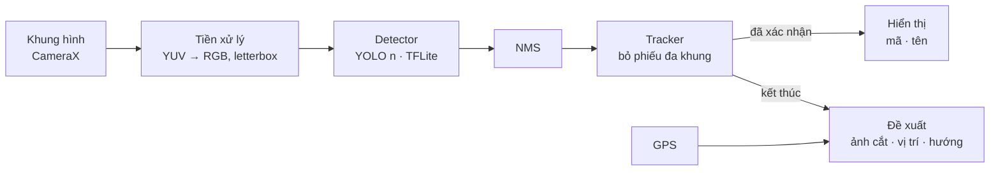
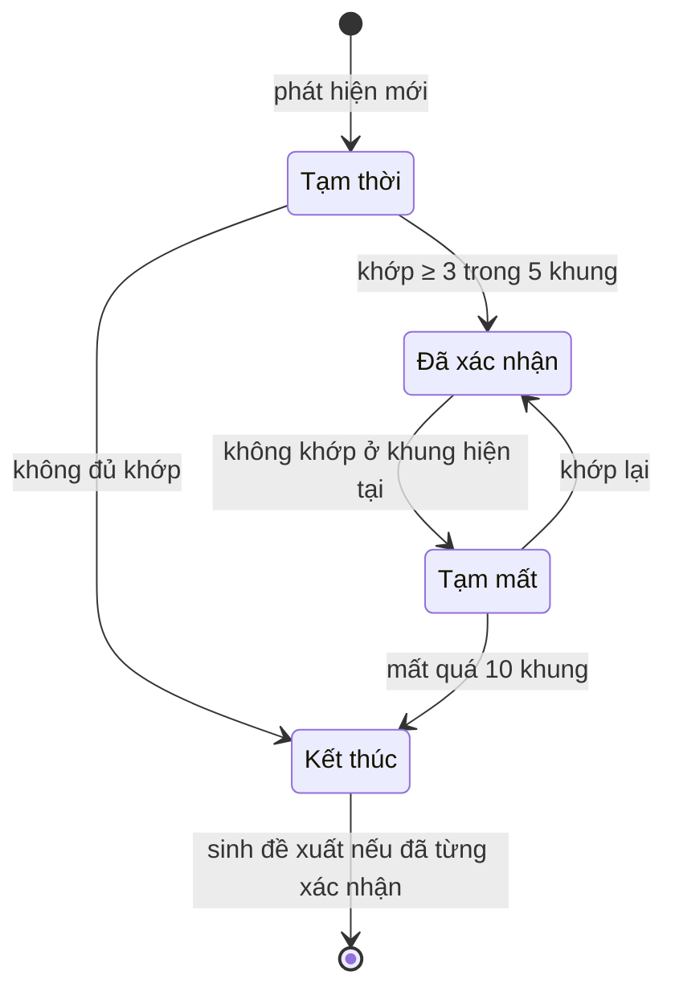
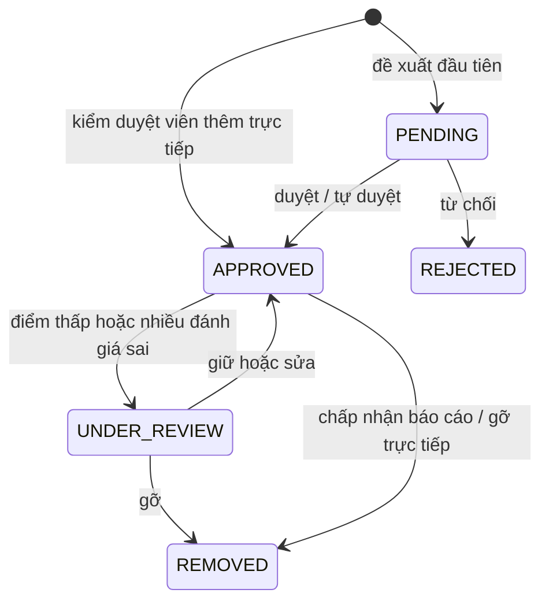

# 04 · Thiết kế AI

Thiết kế phần trí tuệ nhân tạo: bài toán học máy, ba mô hình theo đề tài, giao thức so sánh, nhận diện trên điện thoại, dịch vụ nhận diện trên server, và thuật toán gom cụm, chấm điểm hỗ trợ phê duyệt.

## Mục lục

1. [Bài toán học máy](#1-bài-toán-học-máy)
2. [Ba mô hình](#2-ba-mô-hình)
3. [Giao thức huấn luyện](#3-giao-thức-huấn-luyện)
4. [Giao thức đánh giá và chọn mô hình](#4-giao-thức-đánh-giá-và-chọn-mô-hình)
5. [Nhận diện trên thiết bị](#5-nhận-diện-trên-thiết-bị)
6. [Gom cụm và điểm tin cậy](#6-gom-cụm-và-điểm-tin-cậy)
7. [Dịch vụ nhận diện](#7-dịch-vụ-nhận-diện)
8. [Phiên bản và thẻ mô hình](#8-phiên-bản-và-thẻ-mô-hình)
9. [Rủi ro kỹ thuật](#9-rủi-ro-kỹ-thuật)

## 1. Bài toán học máy

**Phát hiện đối tượng một tầng trên mã biển:** đầu vào là một ảnh RGB; đầu ra là tập các box, mỗi box có **mã biển** theo QCVN 41 và độ tin cậy. Mỗi mã trong [danh mục nhãn](05-du-lieu.md#2-danh-mục-nhãn) là một lớp; biển tốc độ tách theo giá trị (`P.127_50`); mã quá hiếm gộp vào lớp `other_<nhóm>`.

Cả ba mô hình giải **cùng một bài toán, cùng một tập lớp**, nên kết quả so sánh được trực tiếp. Phương án hai tầng (phát hiện theo nhóm rồi phân loại mã) bị loại vì làm phép so sánh 3 mô hình không còn công bằng — lý do: [ADR-0003](adr/0003-mot-tang-so-sanh-ba-mo-hinh.md).

**Đặc thù dữ liệu cần lưu ý khi đọc kết quả:**

| Đặc thù | Hệ quả |
| --- | --- |
| Biển nhỏ: phần lớn box < 32 × 32 px trong ảnh 1080p | Báo cáo AP theo kích thước; thí nghiệm ảnh đầu vào lớn hơn (AI-07) |
| Nhiều mã giống nhau, chỉ khác ký hiệu hoặc con số | Báo cáo ma trận nhầm lẫn; xem các cặp hay nhầm |
| Mất cân bằng lớp mạnh | Báo cáo chỉ số theo từng lớp, không chỉ trung bình |
| Lật ngang đổi nghĩa biển (cấm rẽ trái ↔ cấm rẽ phải) | Tắt `fliplr` ở mọi mô hình |

## 2. Ba mô hình

Ba mô hình đại diện cho ba hướng thiết kế bộ phát hiện, nên so sánh chúng có ý nghĩa vượt ra ngoài "mô hình nào điểm cao hơn":

| | YOLOv5 | YOLOv8 | DETR |
| --- | --- | --- | --- |
| Hướng thiết kế | CNN một giai đoạn, **dùng anchor box** | CNN một giai đoạn, **không dùng anchor**, đầu tách phân loại / hồi quy | **Transformer**, dự đoán tập đối tượng, ghép cặp Hungary, **không cần NMS** |
| Mã nguồn | `ultralytics/yolov5` (bản gốc dùng anchor) | Gói `ultralytics` | DETR-R50 gốc qua `transformers`; RT-DETR trong gói `ultralytics` làm thử nghiệm bổ sung ([Đặc tả · Q2](02-dac-ta-yeu-cau.md#11-vấn-đề-cần-làm-rõ)) |
| Biến thể so sánh | `n`, `s` | `n`, `s` | DETR-R50, bổ sung RT-DETR-L |
| Khởi tạo | Trọng số COCO | Trọng số COCO | Trọng số COCO |
| Chạy trên điện thoại | Được | Được | Không — quá nặng cho 15 FPS |
| Giả thuyết cần kiểm chứng | Ổn định, nhẹ, nhưng anchor cố định kém với biển rất nhỏ | Chính xác hơn v5 cùng cỡ, nhất là biển nhỏ | Mạnh với ngữ cảnh toàn ảnh, nhưng yếu với biển nhỏ và hội tụ chậm |

**Vì sao dùng `yolov5` bản gốc thay vì `yolov5u`:** `yolov5u` trong gói `ultralytics` đã đổi sang đầu không dùng anchor của YOLOv8, nên so sánh với YOLOv8 sẽ chỉ còn khác ở backbone. Bản gốc giữ đúng đặc trưng "dùng anchor" của YOLOv5.

Đề tài ghi đích danh DETR, nên DETR-R50 gốc là mô hình bắt buộc. Nhóm chấp nhận chi phí GPU của DETR gốc trên Colab. RT-DETR-L được báo cáo riêng như thử nghiệm bổ sung, vì dùng chung công cụ với YOLOv8 và hội tụ nhanh hơn.

## 3. Giao thức huấn luyện

Mục tiêu là **so sánh công bằng** trên cùng dữ liệu và bộ chấm. Các lượt chính dùng chung quy tắc dưới đây và ghi rõ khác biệt khi chọn checkpoint.

| Hạng mục | Quy định chung cho mọi mô hình |
| --- | --- |
| Dữ liệu | Cùng phiên bản dữ liệu, cùng tập train / val ([Dữ liệu §5](05-du-lieu.md#5-phân-chia-tập-dữ-liệu)) |
| Kích thước ảnh | 640 × 640 letterbox; thí nghiệm 960 ở AI-07 |
| Tăng cường | Cùng tập phép biến đổi trong lượt so sánh chính ở [Dữ liệu §6](05-du-lieu.md#6-tăng-cường-dữ-liệu) |
| Chọn checkpoint và dừng huấn luyện | Theo mAP@0.5:0.95 trên val, patience 30 epoch. YOLO dùng validator nội bộ; DETR-R50 dùng `signa_ai.evaluate`. Trần epoch: YOLO 200, RT-DETR 150, DETR-R50 300 |
| Chọn siêu tham số | Chỉ dùng val để chọn mô hình, ngưỡng và tham số. Dùng các tuyến val riêng để chỉnh tracker và gom cụm |
| Lặp lại | Mỗi cấu hình chạy với 2 seed nếu đủ GPU; báo cáo trung bình và độ lệch |
| Ghi lại | `ai/experiments/<mã thí nghiệm>/`: cấu hình, phiên bản dữ liệu, commit, log, trọng số tốt nhất, số giờ GPU |

So sánh cuối dùng `signa_ai.evaluate` cho mọi checkpoint. Với YOLOv8s, cùng checkpoint ở epoch 166 đạt mAP@0.5:0.95 **69,56%** theo bộ chấm chung và **73,63%** theo validator dùng để chọn checkpoint. [Kết quả val](../ai/experiments/yolov8s-640-v1.1-main-s0/metrics.json), [Điểm chọn checkpoint](../ai/experiments/yolov8s-640-v1.1-main-s0/best-selection.json)

## 4. Giao thức đánh giá và chọn mô hình

### Một bộ đánh giá cho cả ba

Mỗi bộ công cụ tự tính mAP theo cách hơi khác nhau. Để công bằng, mọi mô hình **xuất dự đoán trên tập test ra cùng định dạng COCO JSON**, rồi tính chỉ số bằng **một** script dùng `pycocotools` (`ai/src/signa_ai/evaluate.py`). Ngưỡng tin cậy khi xuất dự đoán là 0,001 để đường precision–recall đầy đủ.

### Chỉ số

| Nhóm | Chỉ số |
| --- | --- |
| Độ chính xác | mAP@0.5, mAP@0.5:0.95, precision và recall ở ngưỡng vận hành |
| Theo lớp | AP và recall từng mã; recall nhóm biển cấm (NFR-06) |
| Theo kích thước | AP nhỏ (< 32² px), vừa, lớn (> 96² px) |
| Theo điều kiện | mAP tách ngày, đêm, mưa |
| Lỗi | Ma trận nhầm lẫn; 10 cặp mã hay nhầm nhất |
| Chi phí | Số tham số, GFLOPs, kích thước file, thời gian suy luận trên server tham chiếu (CPU và GPU nếu có), FPS trên điện thoại (mô hình YOLO) |
| Huấn luyện | Số epoch đến hội tụ, số giờ GPU |

### Chọn mô hình triển khai — AI-04

**Cấu hình chấm test.** Dùng val để chọn ngưỡng và ứng viên cần đánh giá. Khóa checkpoint hoặc tệp TFLite bằng SHA-256, kích thước ảnh, thiết lập xuất và ngưỡng trước khi chấm test. Server dùng ngưỡng F1 tối đa trên val. Điện thoại chọn ngưỡng ưu tiên recall trên val vì tracker lọc nhiễu. Giữ các giá trị đã khóa khi chấm test. [Bảng cấu hình v1.1](../ai/experiments/model-selection-v1.1.md#chốt-cấu-hình-trước-khi-đo-test)

**Cấu hình triển khai.** Chốt sau khi có số đo FPS trên Android và NFR-02 trên server tham chiếu theo Q7. Xếp hạng theo val. Dùng recall trên ảnh test trước tracker để kiểm tra ứng viên điện thoại đạt mốc NFR-06 tại ngưỡng đã khóa.

| Vai trò | Ứng viên | Quy tắc chọn |
| --- | --- | --- |
| Mặc định trên server (FR-02) | Cả ba | mAP@0.5:0.95 trên val cao nhất trong các mô hình đạt NFR-02 về thời gian |
| Trên điện thoại (FR-03) | YOLOv5n, YOLOv8n, ở 640 hoặc 480 px, INT8 hoặc FP16 | Chọn mAP@0.5 val cao nhất trong các cấu hình đạt ≥ 15 FPS (NFR-01), < 15 MB (NFR-07) và recall biển cấm ≥ 0,85 trên ảnh test trước tracker (NFR-06). Đo FPS khi phát lại video val trên thiết bị tham chiếu |

Khóa cấu hình triển khai trước khi nghiệm thu trên video thực địa. Nghiệm thu NFR-06 theo biển thật trên tuyến, sau tracker. [Kiểm thử §5](08-kiem-thu.md#5-thử-nghiệm-thực-địa)

## 5. Nhận diện trên thiết bị

### Chuỗi xử lý



| Bước | Ngân sách (khung 66 ms cho 15 FPS) | Ghi chú |
| --- | --- | --- |
| Tiền xử lý | ≤ 8 ms | |
| Detector | ≤ 40 ms | GPU delegate, dự phòng CPU XNNPACK |
| NMS + tracker | ≤ 3 ms | Thuần Kotlin |
| Dự phòng | ≥ 15 ms | |

CameraX dùng `STRATEGY_KEEP_ONLY_LATEST`: xử lý chậm thì bỏ khung cũ, không dồn hàng đợi. Máy nóng (`PowerManager` báo mức nhiệt ≥ `THERMAL_STATUS_MODERATE`) thì xử lý cách một khung.

### Tracker

Một biển xuất hiện trong nhiều khung liên tiếp. Tracker gom chúng thành một **track** để không hiển thị nhiễu của một khung, bỏ phiếu mã từ nhiều góc nhìn, và sinh đúng **một** đề xuất cho mỗi biển.

1. **Ghép:** với mỗi khung, ghép phát hiện vào track đang mở theo IoU lớn nhất (tham lam, IoU ≥ 0,3), không phân biệt mã — mã do bỏ phiếu quyết định.
2. **Bỏ phiếu:** mỗi phát hiện cộng `độ tin cậy × diện tích box` vào phiếu của mã đó; biển càng gần càng rõ nên phiếu nặng hơn.
3. **Trạng thái:** theo sơ đồ bên dưới.
4. **Khi kết thúc:** mã của track là mã có phiếu lớn nhất. Nếu mã đó chiếm < 60% tổng phiếu, đề xuất mang cờ `SPLIT_VOTE` để backend hạ trọng số.



| Tham số | Giá trị khởi đầu | Hiệu chỉnh trên |
| --- | --- | --- |
| Số khung khớp để xác nhận | 3 trong 5 | Video val |
| Số khung mất tối đa | 10 | Video val |
| IoU tối thiểu khi ghép | 0,3 | Video val |
| Tỉ lệ phiếu tối thiểu | 0,6 | Video val |

### Đề xuất từ track

| Trường | Cách lấy |
| --- | --- |
| Mã, độ tin cậy | Mã thắng phiếu; độ tin cậy = trung bình độ tin cậy của các phát hiện mang mã đó |
| Ảnh cắt | Box lớn nhất mang mã thắng, nới 10% mỗi cạnh, JPEG chất lượng 85, cạnh dài ≤ 256 px |
| Vị trí | Toạ độ GPS tại khung có box lớn nhất (lúc xe gần biển nhất) |
| Hướng | Hướng di chuyển GPS tại khung đó; không có nếu tốc độ < 5 km/h |
| Phiên bản | `modelName`, `modelVersion`, `labelMapVersion` |

Sai số vị trí chấp nhận được là ≤ 15 m, nhỏ hơn bán kính gom cụm (§6). Ước lượng khoảng cách tới biển từ chiều cao box (`d = f_px × H_thực / h_px`) để dịch toạ độ là cải tiến tuỳ chọn, chỉ làm nếu đo thực địa cho thấy sai số vượt 15 m.

### Đề xuất từ ảnh chụp

Kết quả API nhận diện trả box trong hệ tọa độ ảnh ứng dụng đã gửi. Ứng dụng chuẩn hóa hướng ảnh trước khi tải lên và dùng chính ảnh đó để cắt vùng biển. Vị trí lấy từ GPS lúc chụp (hoặc EXIF nếu chọn từ thư viện). Nếu thiếu vị trí, người dùng ghim trên bản đồ. Đề xuất từ ảnh chụp có hướng là `null`. Nếu người dùng sửa mã trước khi gửi, đề xuất mang cờ `USER_EDITED`.

## 6. Gom cụm và điểm tin cậy

Chạy trong clustering worker của backend ([Kiến trúc §6.3](03-kien-truc.md#6-luồng-xử-lý-chính)). Mỗi **biển** đại diện cho một biển thật; mỗi **đề xuất** được gán vào đúng một biển.

### Gán đề xuất vào biển

1. Tìm các biển **cùng nhóm** với mã đề xuất, cách ≤ 20 m. Nếu cả hai bên có hướng thì hướng lệch ≤ 45°. Bỏ qua `REMOVED` và các biển đã bị từ chối hơn 30 ngày.
2. Ưu tiên biển `APPROVED`/`UNDER_REVIEW` **cùng mã** gần nhất → đề xuất trở thành một xác nhận cho biển đó.
3. Nếu có biển `PENDING` phù hợp → gán vào biển gần nhất.
4. Nếu có biển `REJECTED` cùng mã trong 30 ngày qua → gán vào biển đó và từ chối đề xuất.
5. Tạo biển `PENDING` tại vị trí đề xuất. Nếu có biển `APPROVED` hoặc `UNDER_REVIEW` khác mã phù hợp, thêm cờ `DIFFERS_FROM_APPROVED` và liên kết tới biển gần nhất.

Gom theo nhóm giúp các mã cạnh tranh của một biển xuất hiện trong cùng hồ sơ kiểm duyệt. Phạm vi từ chối trong 30 ngày chỉ áp dụng cho mã đã bị từ chối.

### Trọng số

Mỗi đề xuất có trọng số `w = p × k × f`:

| Thành phần | Ý nghĩa |
| --- | --- |
| `p` | Độ tin cậy của mô hình; đề xuất `USER_EDITED` dùng `p = 0,7` cố định vì là nhãn của người |
| `k` | Chống lặp: mỗi người góp trọng số tối đa một lần mỗi 12 giờ cho một biển (tính theo giờ server nhận); các lần sau `k = 0` |
| `f` | `0,5` nếu có cờ `SPLIT_VOTE`, ngược lại `1` |

Biển giữ tổng trọng số theo từng mã `W_c` (bảng `sign_code_weights`). **Mã dẫn đầu** `c*` là mã có `W_c` lớn nhất; với biển đã duyệt, mã dẫn đầu là mã kiểm duyệt viên chốt.

### Điểm tin cậy

Điểm là kỳ vọng hậu nghiệm của phân phối Beta, với tiên nghiệm Jeffreys `Beta(0,5; 0,5)` — không thiên về có hay không có biển khi chưa có bằng chứng:

```math
\alpha = 0{,}5 + W_{c^*} + R_{+} + M, \qquad
\beta = 0{,}5 + \sum_{c \ne c^*} W_c + R_{-}, \qquad
\text{điểm} = \frac{\alpha}{\alpha + \beta}
```

| Ký hiệu | Ý nghĩa |
| --- | --- |
| `R+`, `R−` | Số đánh giá "còn đúng" / "không đúng" (FR-09), mỗi đánh giá trọng số 1 |
| `M` | `2` nếu kiểm duyệt viên đã duyệt hoặc tạo biển, ngược lại `0` |

Ví dụ: 2 người, `p = 0,9` → `α = 2,3`, `β = 0,5` → điểm 0,82. Một người → 0,74. Biển đã duyệt từ 2 người nhận 2 đánh giá "không đúng" → `α = 4,3`, `β = 2,5` → 0,63.

### Gợi ý cho kiểm duyệt viên — FR-21

Với `s2` là tỉ lệ trọng số của mã đứng thứ hai trên tổng trọng số, `n` là số người đề xuất khác nhau:

| Gợi ý | Điều kiện, xét theo thứ tự |
| --- | --- |
| **Cần xem kỹ** | `s2 ≥ 0,3`, hoặc cờ `DIFFERS_FROM_APPROVED`, hoặc biển `UNDER_REVIEW` |
| **Nên duyệt** | điểm ≥ 0,8 và `n ≥ 2` |
| **Chờ thêm** | Còn lại |

**Tự duyệt (FR-25, mặc định tắt):** biển `PENDING` có gợi ý **Nên duyệt**, điểm ≥ 0,85, `n ≥ 3` và `s2 < 0,1`.

**Rà soát lại (FR-22):** biển `APPROVED` có điểm < 0,5, hoặc ≥ 3 đánh giá "không đúng" từ người khác nhau kể từ lần duyệt gần nhất, chuyển `UNDER_REVIEW`.

### Trạng thái biển



Khi biển chuyển trạng thái, các đề xuất thành viên cập nhật theo: biển `APPROVED` → đề xuất cùng mã `ACCEPTED`, khác mã `REJECTED`; biển `REJECTED` → mọi đề xuất `REJECTED`.

**Vị trí biển** là trung vị có trọng số theo `w` của vị trí các đề xuất mang mã dẫn đầu, tính lại khi có đề xuất mới, cho tới khi kiểm duyệt viên chốt vị trí.

### Đánh giá hiệu quả — mục tiêu G4

So sánh hai cách phê duyệt trên cùng tập đề xuất từ thử nghiệm thực địa. Tắt FR-25 cho phép đo G4 để đo riêng hiệu quả gom cụm và gợi ý. Đo tự duyệt trong một lượt riêng ([Kiểm thử §6](08-kiem-thu.md#6-đánh-giá-phê-duyệt-có-trợ-giúp)).

| | Phê duyệt từng đề xuất (đối chứng) | Phê duyệt có trợ giúp |
| --- | --- | --- |
| Đơn vị quyết định | Mỗi đề xuất | Mỗi biển `PENDING` hoặc `UNDER_REVIEW` cần kiểm duyệt |
| Số quyết định | = số đề xuất | Đo |
| Precision bản đồ | Đo | Đo |

Thêm thí nghiệm **chèn nhiễu** để kiểm tra độ bền: x% đề xuất bị đổi sang mã sai, GPS lệch theo phân phối chuẩn σ = 5–15 m, một tài khoản gửi đề xuất giả hàng loạt.

## 7. Dịch vụ nhận diện

| Hạng mục | Thiết kế |
| --- | --- |
| Công nghệ | Python 3.11, FastAPI, Uvicorn, PyTorch; `ultralytics`, `yolov5`, `transformers` theo mô hình |
| Giao diện | Một interface `Detector.predict(image) -> list[Detection]` cho mọi mô hình; mỗi mô hình một adapter |
| Nạp mô hình | Nạp cả ba khi khởi động; `/healthz` chỉ trả `ok` khi nạp xong |
| Thiết bị | CUDA nếu có, ngược lại CPU; cấu hình qua biến môi trường |
| Đồng thời | Semaphore theo mô hình (YOLO 4, DETR 1); hàng chờ tối đa 8 yêu cầu mỗi mô hình, đầy thì `503` |
| Đầu ra | Box theo toạ độ ảnh gốc (pixel), mã, độ tin cậy, `inferenceMs`, `modelName`, `modelVersion`, `labelMapVersion` |
| Thẻ mô hình | `GET /v1/models` trả thẻ mô hình (§8) của cả ba, dùng cho FR-37 |

API chi tiết: [API §7](07-api.md#7-dịch-vụ-nhận-diện-nội-bộ).

## 8. Phiên bản và thẻ mô hình

**Phiên bản** `<kiến trúc>-<cỡ>-vMAJOR.MINOR`, ví dụ `yolov8n-v1.2`: tăng `MAJOR` khi danh mục nhãn thay đổi, tăng `MINOR` khi chỉ huấn luyện lại.

**Thẻ mô hình** (`model_card.json`, AI-06) đi kèm mỗi file mô hình: phiên bản dữ liệu, phiên bản danh mục nhãn, cấu hình huấn luyện, chỉ số trên tập test và tập thực địa (§4), kích thước, tốc độ, hạn chế đã biết.

**Phân phối:**

- Mô hình server: file trọng số và thẻ mô hình đóng vào Docker image của dịch vụ nhận diện, chọn qua biến môi trường.
- Mô hình điện thoại: file `.tflite`, `labels.json` và thẻ mô hình đặt trong `assets/` của ứng dụng; đổi mô hình là phát hành phiên bản ứng dụng mới.

## 9. Rủi ro kỹ thuật

| Rủi ro | Ảnh hưởng | Cách giảm |
| --- | --- | --- |
| Không đủ GPU để huấn luyện DETR | Thiếu một trong ba mô hình bắt buộc | Chốt biến thể ở Q2 và GPU ở Q4. Xếp lịch chạy DETR trước vì thời gian huấn luyện dự kiến dài hơn |
| Dữ liệu ít, nhất là ban đêm, trời mưa | Chỉ số thấp, khó kết luận | Video thực địa riêng; tăng cường dữ liệu; báo cáo theo điều kiện |
| Biển nhỏ, ở xa | Recall thấp | Thí nghiệm 960 px; báo cáo AP theo kích thước |
| Điện thoại yếu, nóng máy | < 15 FPS | INT8, 480 px, xử lý cách khung khi nóng |
| Đề xuất sai hoặc cố ý phá | Biển sai trên bản đồ | Mọi biển qua phê duyệt (tự duyệt chỉ khi ≥ 3 người); chống lặp theo người; đánh giá và báo cáo |
| GPS lệch trong phố hẹp | Vị trí biển lệch, gom cụm sai | Trung vị theo nhiều đề xuất; kiểm duyệt viên kéo vị trí khi duyệt |
| Danh mục nhãn thay đổi giữa chừng | Mô hình, CSDL, ứng dụng lệch nhau | Một nguồn `labels.yaml`; backend từ chối `labelMapVersion` không hỗ trợ |
