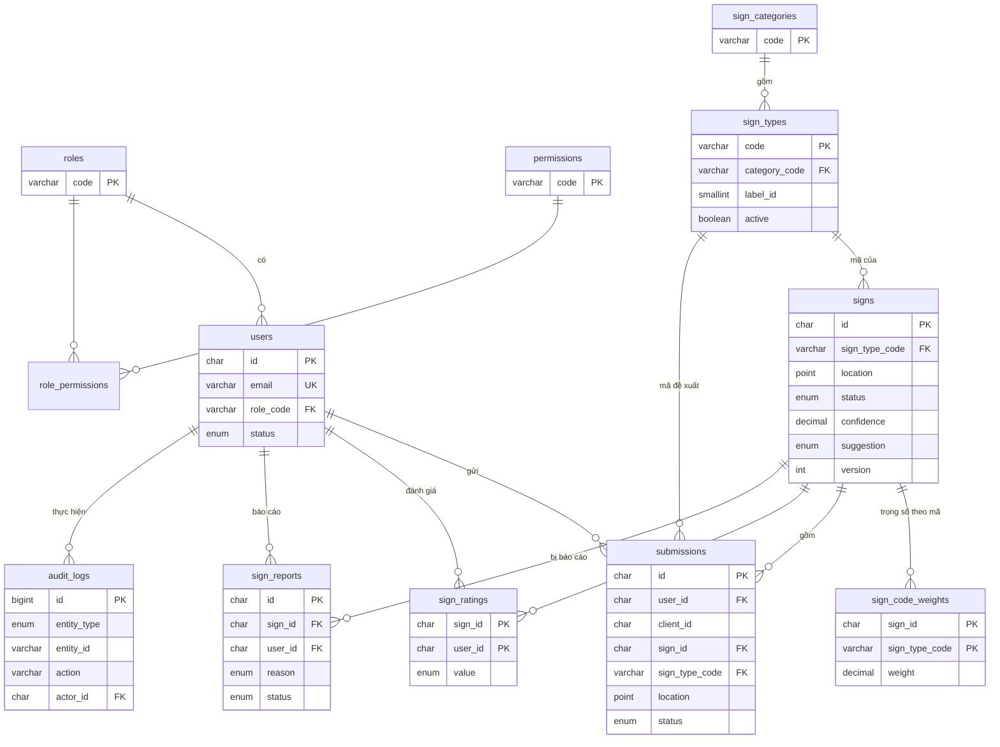

# 06 · Cơ sở dữ liệu

## Mục lục

1. [Tổng quan](#1-tổng-quan)
2. [Đối chiếu với đề tài](#2-đối-chiếu-với-đề-tài)
3. [Sơ đồ quan hệ](#3-sơ-đồ-quan-hệ)
4. [Người dùng và phân quyền](#4-người-dùng-và-phân-quyền)
5. [Danh mục biển](#5-danh-mục-biển)
6. [Biển và đề xuất](#6-biển-và-đề-xuất)
7. [Đánh giá và báo cáo](#7-đánh-giá-và-báo-cáo)
8. [Lịch sử xử lý](#8-lịch-sử-xử-lý)
9. [Truy vấn không gian](#9-truy-vấn-không-gian)
10. [Redis](#10-redis)
11. [MinIO](#11-minio)
12. [Quy ước migration](#12-quy-ước-migration)

## 1. Tổng quan

- MySQL 8, một CSDL `signa`, InnoDB, `utf8mb4`, collation `utf8mb4_0900_ai_ci` (tìm kiếm không phân biệt hoa thường và dấu, phục vụ FR-08).
- Mỗi bảng thuộc đúng một module backend ([Kiến trúc §5](03-kien-truc.md#5-trách-nhiệm-từng-thành-phần)); module khác chỉ đọc qua interface của module sở hữu.
- Khoá chính của thực thể lộ ra API: UUID lưu `CHAR(36)`. Bảng lịch sử dùng `BIGINT AUTO_INCREMENT`.
- Thời gian lưu `DATETIME(3)` theo UTC.
- Toạ độ lưu kiểu `POINT SRID 4326` với `SPATIAL INDEX` (§9).

## 2. Đối chiếu với đề tài

| Nhóm dữ liệu theo đề tài | Bảng |
| --- | --- |
| Người dùng và tài khoản | `users` |
| Phân quyền | `roles`, `permissions`, `role_permissions` |
| Loại biển báo | `sign_categories` |
| Thông tin biển báo | `sign_types` |
| Biển báo giao thông thời gian thực | `signs`, `sign_code_weights`, `submissions` |
| Đánh giá | `sign_ratings` |
| Báo cáo | `sign_reports` |
| Lịch sử cập nhật / xử lý dữ liệu | `audit_logs` |

## 3. Sơ đồ quan hệ



## 4. Người dùng và phân quyền

### roles

| Cột | Kiểu | Ràng buộc | Mô tả |
| --- | --- | --- | --- |
| `code` | VARCHAR(20) | PK | `USER`, `MODERATOR`, `ADMIN` |
| `name` | VARCHAR(100) | NOT NULL | Tên hiển thị |
| `description` | VARCHAR(500) | | |

### permissions

| Cột | Kiểu | Ràng buộc | Mô tả |
| --- | --- | --- | --- |
| `code` | VARCHAR(50) | PK | Ví dụ `review:decide` |
| `description` | VARCHAR(500) | | |

### role_permissions

| Cột | Kiểu | Ràng buộc |
| --- | --- | --- |
| `role_code` | VARCHAR(20) | PK, FK → `roles.code` |
| `permission_code` | VARCHAR(50) | PK, FK → `permissions.code` |

Dữ liệu khởi tạo (migration):

| Quyền | `USER` | `MODERATOR` | `ADMIN` | Dùng cho |
| --- | --- | --- | --- | --- |
| `submission:create` | ✓ | ✓ | ✓ | FR-04 |
| `sign:rate` | ✓ | ✓ | ✓ | FR-09 |
| `report:create` | ✓ | ✓ | ✓ | FR-10 |
| `review:decide` | | ✓ | ✓ | FR-31 |
| `report:resolve` | | ✓ | ✓ | FR-32 |
| `sign:edit` | | ✓ | ✓ | FR-33 |
| `audit:read` | | ✓ | ✓ | FR-34 |
| `stats:read` | | ✓ | ✓ | FR-38 |
| `recognition:compare` | | ✓ | ✓ | FR-37 |
| `catalog:manage` | | | ✓ | FR-35 |
| `user:manage` | | | ✓ | FR-36 |

Backend kiểm tra **quyền**, không kiểm tra tên vai trò, nên đổi phân quyền chỉ cần sửa dữ liệu.

### users

| Cột | Kiểu | Ràng buộc | Mô tả |
| --- | --- | --- | --- |
| `id` | CHAR(36) | PK | |
| `email` | VARCHAR(255) | UNIQUE, NOT NULL | Lưu chữ thường |
| `password_hash` | VARCHAR(100) | NOT NULL | BCrypt, cost 12 |
| `display_name` | VARCHAR(100) | NOT NULL | |
| `role_code` | VARCHAR(20) | FK → `roles.code`, NOT NULL, mặc định `USER` | |
| `status` | ENUM('ACTIVE','LOCKED') | NOT NULL, mặc định `ACTIVE` | |
| `credential_version` | INT | NOT NULL, mặc định 0 | Tăng khi đổi hoặc đặt lại mật khẩu, đổi vai trò hay khoá |
| `retained_session_hash` | CHAR(64) | NULL | Mã băm phiên hiện tại được giữ khi đổi mật khẩu |
| `last_login_at` | DATETIME(3) | NULL | |
| `created_at`, `updated_at` | DATETIME(3) | NOT NULL | |

## 5. Danh mục biển

Hai bảng được nạp và cập nhật từ `ai/data/labels.yaml` bằng lệnh nhập của backend (upsert theo `code`); quản trị viên sửa nội dung hiển thị và thêm loại biển chỉ nhập tay qua FR-35. Lệnh nhập không ghi đè `description`, `icon_key`, `active`, không sửa nhóm đã có, và chỉ đổi `name` khi quản trị viên chưa sửa.

### sign_categories

| Cột | Kiểu | Ràng buộc | Mô tả |
| --- | --- | --- | --- |
| `code` | VARCHAR(20) | PK | `PROHIBITORY`, `MANDATORY`, `WARNING`, `AUXILIARY`, `OTHER` |
| `name` | VARCHAR(100) | NOT NULL | |
| `description` | TEXT | | Đặc điểm nhận biết theo QCVN 41 |
| `sort_order` | SMALLINT | NOT NULL | |

### sign_types

| Cột | Kiểu | Ràng buộc | Mô tả |
| --- | --- | --- | --- |
| `code` | VARCHAR(30) | PK | Mã QCVN 41, ví dụ `P.127_50` |
| `category_code` | VARCHAR(20) | FK → `sign_categories.code`, NOT NULL | |
| `name` | VARCHAR(200) | NOT NULL | |
| `description` | TEXT | | Ý nghĩa, hiệu lực |
| `speed_kmh` | SMALLINT | NULL | Chỉ với biển tốc độ |
| `icon_key` | VARCHAR(255) | NULL | Khoá ảnh minh hoạ trong bucket `sign-icons` |
| `label_id` | SMALLINT | NULL | `id` lớp trong danh mục nhãn; `NULL` nếu chỉ nhập tay |
| `label_map_version` | INT | NULL | Phiên bản danh mục nhãn có lớp này |
| `label_name` | VARCHAR(200) | NULL | Tên lấy từ danh mục nhãn ở lần nạp gần nhất. Lệnh nạp chỉ đổi `name` khi `name` còn bằng giá trị này, tức quản trị viên chưa sửa |
| `active` | BOOLEAN | NOT NULL, mặc định TRUE | Ngừng dùng thay vì xoá |
| `created_at`, `updated_at` | DATETIME(3) | NOT NULL | |

Chỉ mục: `INDEX(category_code, active)`. Danh mục chỉ vài trăm dòng nên tìm theo một phần tên dùng `LIKE` với collation không phân biệt dấu là đủ; ứng dụng tìm trên bản sao trong Room.

## 6. Biển và đề xuất

### signs

| Cột | Kiểu | Ràng buộc | Mô tả |
| --- | --- | --- | --- |
| `id` | CHAR(36) | PK | |
| `sign_type_code` | VARCHAR(30) | FK → `sign_types.code`, NOT NULL | Mã dẫn đầu, hoặc mã đã chốt khi duyệt |
| `category_code` | VARCHAR(20) | NOT NULL | Sao chép từ loại biển, để gom cụm theo nhóm không cần join |
| `location` | POINT SRID 4326 | NOT NULL, SPATIAL INDEX | |
| `heading_deg` | SMALLINT | NULL | 0–359; hướng xe nhìn thấy biển |
| `location_locked` | BOOLEAN | NOT NULL, mặc định FALSE | TRUE khi kiểm duyệt viên chốt vị trí |
| `status` | ENUM('PENDING','APPROVED','UNDER_REVIEW','REJECTED','REMOVED') | NOT NULL | |
| `confidence` | DECIMAL(5,4) | NOT NULL | Điểm tin cậy ([Thiết kế AI §6](04-thiet-ke-ai.md#6-gom-cụm-và-điểm-tin-cậy)) |
| `suggestion` | ENUM('APPROVE','INSPECT','WAIT') | NULL | Gợi ý; `NULL` khi đã duyệt |
| `distinct_submitters` | INT | NOT NULL, mặc định 0 | |
| `confirm_count`, `deny_count` | INT | NOT NULL, mặc định 0 | Tổng đánh giá |
| `deny_since_review` | INT | NOT NULL, mặc định 0 | Đánh giá "không đúng" từ lần duyệt gần nhất |
| `moderator_boost` | DECIMAL(4,2) | NOT NULL, mặc định 0 | `M` trong công thức điểm |
| `flags` | JSON | NOT NULL, mặc định `[]` | Ví dụ `["DIFFERS_FROM_APPROVED"]` |
| `related_sign_id` | CHAR(36) | NULL, FK → `signs.id` | Biển đã duyệt mà biển này khác mã |
| `cover_crop_key` | VARCHAR(255) | NULL | Ảnh cắt đại diện |
| `reviewed_by` | CHAR(36) | NULL, FK → `users.id` | |
| `reviewed_at` | DATETIME(3) | NULL | Thời điểm quyết định gần nhất, dùng để tính thời hạn từ chối 30 ngày |
| `version` | INT | NOT NULL, mặc định 0 | Khoá lạc quan khi phê duyệt. Tăng khi cập nhật dữ liệu biển hoặc bằng chứng được hiển thị cho người duyệt |
| `created_at`, `updated_at` | DATETIME(3) | NOT NULL | |

Chỉ mục: `SPATIAL(location)`; `(status, suggestion, confidence)` cho hàng đợi phê duyệt; `(category_code, status)`.

### sign_code_weights

| Cột | Kiểu | Ràng buộc | Mô tả |
| --- | --- | --- | --- |
| `sign_id` | CHAR(36) | PK, FK → `signs.id` | |
| `sign_type_code` | VARCHAR(30) | PK, FK → `sign_types.code` | |
| `weight` | DECIMAL(10,4) | NOT NULL | `W_c` |
| `submitter_count` | INT | NOT NULL | Số người khác nhau đề xuất mã này |

### submissions

| Cột | Kiểu | Ràng buộc | Mô tả |
| --- | --- | --- | --- |
| `id` | CHAR(36) | PK | |
| `user_id` | CHAR(36) | FK → `users.id`, NOT NULL | |
| `client_id` | CHAR(36) | NOT NULL, UNIQUE `(user_id, client_id)` | Do ứng dụng sinh, chống gửi trùng |
| `sign_id` | CHAR(36) | NULL, FK → `signs.id` | Gán sau khi gom cụm |
| `sign_type_code` | VARCHAR(30) | FK → `sign_types.code`, NOT NULL | |
| `confidence` | DECIMAL(5,4) | NOT NULL | Độ tin cậy mô hình |
| `weight` | DECIMAL(6,4) | NULL | `w`, tính khi gom cụm |
| `location` | POINT SRID 4326 | NOT NULL | |
| `heading_deg` | SMALLINT | NULL | |
| `source` | ENUM('CAMERA','PHOTO') | NOT NULL | |
| `flags` | JSON | NOT NULL, mặc định `[]` | `SPLIT_VOTE`, `USER_EDITED` |
| `crop_key` | VARCHAR(255) | NOT NULL | Khoá ảnh cắt trong `sign-crops` |
| `model_name`, `model_version` | VARCHAR(50) | NOT NULL | |
| `label_map_version` | INT | NOT NULL | |
| `captured_at` | DATETIME(3) | NOT NULL | Thời điểm trên thiết bị, chỉ để hiển thị |
| `received_at` | DATETIME(3) | NOT NULL | Thời điểm server nhận, dùng cho chống lặp |
| `status` | ENUM('RECEIVED','GROUPED','ACCEPTED','REJECTED') | NOT NULL | |
| `reject_reason` | VARCHAR(500) | NULL | |

Chỉ mục: `(sign_id, user_id, received_at)` cho luật chống lặp 12 giờ; `(user_id, received_at)` cho FR-11; `(status, received_at)` cho quét lại đề xuất chờ; `(crop_key)` cho đối chiếu ảnh trong MinIO.

## 7. Đánh giá và báo cáo

### sign_ratings

| Cột | Kiểu | Ràng buộc | Mô tả |
| --- | --- | --- | --- |
| `sign_id` | CHAR(36) | PK, FK → `signs.id` | |
| `user_id` | CHAR(36) | PK, FK → `users.id` | Một đánh giá mỗi người mỗi biển |
| `value` | ENUM('CONFIRM','DENY') | NOT NULL | "Còn đúng" / "Không đúng" |
| `created_at`, `updated_at` | DATETIME(3) | NOT NULL | |

### sign_reports

| Cột | Kiểu | Ràng buộc | Mô tả |
| --- | --- | --- | --- |
| `id` | CHAR(36) | PK | |
| `sign_id` | CHAR(36) | FK → `signs.id`, NOT NULL | |
| `user_id` | CHAR(36) | FK → `users.id`, NOT NULL | |
| `reason` | ENUM('NOT_EXIST','WRONG_TYPE','WRONG_LOCATION','OTHER') | NOT NULL | |
| `description` | VARCHAR(1000) | NULL | Bắt buộc khi `OTHER` |
| `photo_key` | VARCHAR(255) | NULL | Ảnh trong `report-photos` |
| `status` | ENUM('PENDING','ACCEPTED','DISMISSED') | NOT NULL | |
| `resolution` | ENUM('EDITED','REMOVED') | NULL | Khi `ACCEPTED` |
| `resolution_note` | VARCHAR(1000) | NULL | Bắt buộc khi `DISMISSED` |
| `resolved_by` | CHAR(36) | NULL, FK → `users.id` | |
| `resolved_at` | DATETIME(3) | NULL | |
| `created_at` | DATETIME(3) | NOT NULL | |
| `pending_flag` | TINYINT | GENERATED AS `(IF(status = 'PENDING', 1, NULL))` STORED | |

Ràng buộc `UNIQUE(sign_id, user_id, pending_flag)`: MySQL cho phép nhiều `NULL` trong chỉ mục duy nhất, nên mỗi người chỉ có **một** báo cáo đang chờ cho mỗi biển nhưng có nhiều báo cáo đã xử lý (FR-10).

## 8. Lịch sử xử lý

### audit_logs

| Cột | Kiểu | Ràng buộc | Mô tả |
| --- | --- | --- | --- |
| `id` | BIGINT | PK, AUTO_INCREMENT | |
| `entity_type` | ENUM('SIGN','REPORT','SIGN_TYPE','SIGN_CATEGORY','USER') | NOT NULL | |
| `entity_id` | VARCHAR(36) | NOT NULL | |
| `action` | VARCHAR(40) | NOT NULL | Bảng dưới |
| `actor_type` | ENUM('USER','SYSTEM') | NOT NULL | |
| `actor_id` | CHAR(36) | NULL, FK → `users.id` | `NULL` khi `SYSTEM` |
| `before_value` | JSON | NULL | Các trường thay đổi, giá trị trước |
| `after_value` | JSON | NULL | Giá trị sau |
| `reason` | VARCHAR(1000) | NULL | |
| `request_id` | VARCHAR(64) | NULL | Truy vết với log |
| `created_at` | DATETIME(3) | NOT NULL | |

Chỉ mục: `(entity_type, entity_id, created_at)`, `(actor_id, created_at)`, `(action, created_at)`.

| `entity_type` | `action` |
| --- | --- |
| `SIGN` | `CREATED`, `LEADING_CODE_CHANGED`, `LOCATION_RECOMPUTED`, `APPROVED`, `AUTO_APPROVED`, `REJECTED`, `EDITED`, `MARKED_UNDER_REVIEW`, `KEPT`, `REMOVED` |
| `REPORT` | `ACCEPTED`, `DISMISSED` |
| `SIGN_TYPE`, `SIGN_CATEGORY` | `CREATED`, `UPDATED`, `DEACTIVATED` |
| `USER` | `ROLE_CHANGED`, `LOCKED`, `UNLOCKED` |

Tài khoản CSDL của backend chỉ được cấp `SELECT, INSERT` trên `audit_logs` (FR-23). Migration chạy bằng tài khoản riêng. Bản ghi lịch sử được ghi trong cùng giao dịch với thao tác tạo biển hoặc thay đổi trạng thái, mã, vị trí (NFR-11).

## 9. Truy vấn không gian

MySQL 8 hiểu SRID 4326 theo thứ tự trục **vĩ độ trước**. Để tránh nhầm, mọi câu lệnh tạo điểm dùng tuỳ chọn thứ tự trục tường minh:

```sql
ST_GeomFromText('POINT(105.8048 21.0285)', 4326, 'axis-order=long-lat')
```

**Biển trong vùng** (FR-05, NFR-03):

```sql
SELECT id, sign_type_code, ST_Latitude(location) AS lat, ST_Longitude(location) AS lng, status, confidence
FROM signs
WHERE MBRContains(ST_GeomFromText(:bboxPolygon, 4326, 'axis-order=long-lat'), location)
  AND status IN ('APPROVED', 'UNDER_REVIEW')
  AND category_code IN (:categories)
LIMIT 501;
```

Truy vấn áp dụng các bộ lọc nhóm và mã biển khi có tham số. Nếu tìm được 501 dòng, backend chạy truy vấn gom theo ô lưới với cùng bộ lọc trên toàn vùng. Số đếm mỗi ô lấy từ toàn bộ kết quả, kể cả các biển nằm ngoài 501 dòng đầu.

**Biển gần một đề xuất** (gom cụm, bán kính 20 m): lọc thô bằng `MBRContains` với nửa cạnh `Δlat = 20 / 111 320` và `Δlng = 20 / (111 320 · cos(lat))` độ, mở biên nhỏ theo hình cầu. Qua kinh tuyến đổi ngày thì tách khung và xét cả biên. Nếu vòng tròn chạm cực, chỉ lọc thô theo vĩ độ. Lọc chính xác bằng `ST_Distance_Sphere(location, :p, 6370986) <= 20` để cùng bán kính Trái Đất với lõi gom cụm.

## 10. Redis

| Khoá | Kiểu | TTL | Mục đích |
| --- | --- | --- | --- |
| `session:{sha256(token)}` | Hash `userId`, `credentialVersion`, `client`, `createdAt` | 30 ngày (`MOBILE`), 8 giờ (`WEB`); gia hạn đủ thời hạn mỗi lần dùng | Phiên đăng nhập. Khoá là SHA-256 hex của token, Redis không giữ token thô |
| `user-sessions:{userId}` | Set `sha256(token)` | Không; mục đã hết hạn được dọn mỗi lần tạo phiên mới | Dọn các phiên có phiên bản cũ sau commit |
| `otp:{sha256(email)}` | Hash `codeHash` (HMAC-SHA256 dạng hex), `attempts` | 10 phút, tính từ lần cấp mã gần nhất | FR-13, email đã chuẩn hoá. Xoá khi dùng thành công hoặc nhập sai lần thứ 5 |
| `rl:otp:{sha256(email)}:{ip}` | Counter | 15 phút, tính từ yêu cầu đầu | Tối đa 3 yêu cầu gửi OTP theo cặp email chuẩn hoá và IP, kể cả email không tồn tại |
| `rl:login:{email}:{ip}` | Counter | 15 phút, tính từ lần thử đầu | Giới hạn đăng nhập: mỗi lần thử `INCR` trước khi so mật khẩu, lần thứ 11 trả `429`; đúng mật khẩu thì xoá |
| `rl:password:{userId}` | Counter | 15 phút, tính từ lần thử đầu | Giới hạn nhập mật khẩu hiện tại khi đổi mật khẩu, cùng cách đếm với `rl:login` |
| `rl:recognize:{userId hoặc ip}` | Counter | 1 phút | Giới hạn nhận diện ảnh |
| `cache:sign-types` | String JSON + ETag | Xoá khi danh mục đổi | FR-08 |
| `stream:submissions` | Stream, group `clustering` | Xoá mục sau khi xử lý và xác nhận | Hàng đợi gom cụm ([ADR-0007](adr/0007-gom-cum-tuan-tu-qua-redis-stream.md)) |

Mỗi request có phiên Redis đọc phiên bản, trạng thái và vai trò hiện hành từ
MySQL theo khoá chính. Đọc trực tiếp giúp thu hồi có hiệu lực ngay khi MySQL
commit, trên mọi instance backend. Quyền được tra từ bảng quyền của vai trò
hiện hành đã nạp khi khởi động. Sau BCrypt, đăng nhập đọc lại và khoá dòng
người dùng trong giao dịch cấp phiên. Nếu phiên bản đã đổi, client phải
đăng nhập lại.

Dọn Redis chạy sau commit và thử tối đa ba lần, chỉ xoá phiên cũ hơn phiên
bản đã commit. Đổi mật khẩu ghi cùng giao dịch mã băm của phiên được giữ.
Nếu Redis chưa cập nhật kịp, request tiếp theo của chính phiên đó có thể
chuyển phiên sang phiên bản mới. Phiên Redis cũ thiếu trường phiên bản phải
đăng nhập lại sau khi nâng cấp.

Khi Redis mất dữ liệu, người dùng đăng nhập lại. Worker quét các đề xuất còn `RECEIVED` khi khởi động và định kỳ để đưa chúng trở lại stream.

## 11. MinIO

| Bucket | Nội dung | Truy cập | Lưu giữ |
| --- | --- | --- | --- |
| `sign-crops` | Ảnh cắt của đề xuất, `{submissionId}.jpg` | Riêng tư; URL ký 10 phút | Theo vòng đời biển; xoá sau 90 ngày nếu biển `REJECTED` |
| `report-photos` | Ảnh đính kèm báo cáo | Riêng tư; URL ký 10 phút | Xoá 90 ngày sau khi báo cáo được xử lý |
| `sign-icons` | Ảnh minh hoạ chuẩn của loại biển | Đọc công khai qua nginx `/icons/` | Lâu dài |

Ảnh gửi để nhận diện (FR-02) **không** có bucket: chỉ nằm trong bộ nhớ của request (NFR-09).

## 12. Quy ước migration

- Flyway, thư mục `backend/src/main/resources/db/migration`, tên `V{n}__{mo_ta}.sql`; là nguồn chuẩn của lược đồ.
- Không sửa migration đã chạy trên `dev`; sửa bằng migration mới.
- Vai trò và quyền nằm trong migration; danh mục biển nạp từ `labels.yaml` bằng lệnh nhập riêng.
- Dữ liệu mẫu cho demo (`R__demo_data.sql`) chỉ chạy khi bật profile `demo`.
