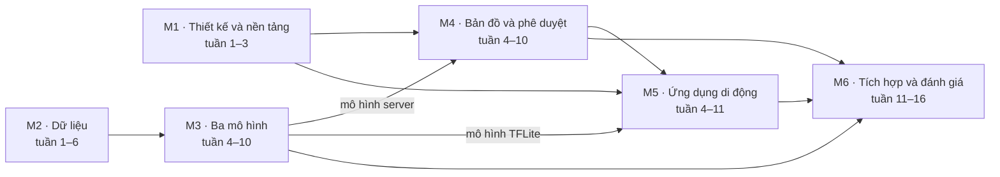

# 09 · Hạng mục công việc

Kế hoạch 16 tuần cho nhóm 3 người. Mỗi chủ đề là một **milestone** trên GitHub; mỗi đầu ra tương ứng một hoặc nhiều **issue**. Phân kỳ tổng thể: [Đặc tả §12](02-dac-ta-yeu-cau.md#12-thời-gian-và-phân-kỳ).

## Sơ đồ phụ thuộc

**Đường găng:** M2 → M3 → M6. Dữ liệu chậm thì mọi thứ phía sau chậm theo, nên tuần 1–6 thành viên 1 chỉ làm dữ liệu và mô hình; mô hình tạm (YOLOv8n huấn luyện trên bộ dữ liệu công khai) được giao cho thành viên 2 và 3 từ tuần 4 để không ai phải chờ.

## Phân công theo tuần

| Tuần | Thành viên 1 · AI và dữ liệu | Thành viên 2 · Backend, web | Thành viên 3 · Di động |
| --- | --- | --- | --- |
| 1–2 | Danh mục nhãn nháp; khảo sát và kiểm tra giấy phép dữ liệu | Rà soát tài liệu; hợp đồng API; khung backend một khối | Rà soát tài liệu; khung ứng dụng; màn hình mẫu |
| 3 | Gán nhãn dữ liệu công khai; quay video đợt 1 | Tài khoản, phân quyền, danh mục | Tài khoản, tra cứu offline |
| 4 | Gán nhãn; mô hình tạm YOLOv8n **đã huấn luyện** ([hồ sơ](../ai/experiments/yolov8n-640-v1.1-temp-s0/)) | Dịch vụ nhận diện (mô hình tạm), API nhận diện | Nhận diện ảnh qua server |
| 5 | **Dữ liệu v1.0**; bắt đầu huấn luyện DETR | API biển theo vùng, bản đồ trên web | Màn hình bản đồ, chi tiết biển |
| 6 | Huấn luyện YOLOv5, YOLOv8 | Đề xuất, worker gom cụm, điểm tin cậy | Tích hợp TFLite, FrameAnalyzer |
| 7 | Bộ đánh giá chung; **baseline cả 3 mô hình** | Hàng đợi phê duyệt, lịch sử xử lý | Tracker, đề xuất từ camera |
| 8 | Video đợt 2 (đêm, mưa); tách video val và tập thực địa theo tuyến | Trang phê duyệt trên web | Gửi đề xuất, hàng đợi offline; **đo FPS lần đầu trên video val** |
| 9 | Thí nghiệm AI-07; xuất TFLite các ứng viên | Đánh giá, báo cáo, xử lý báo cáo | Đánh giá, báo cáo trên ứng dụng |
| 10 | Chọn mô hình triển khai (AI-04); thẻ mô hình | Danh mục, người dùng trên web; đưa mô hình cuối vào dịch vụ | Đưa mô hình cuối vào ứng dụng; đo trên 2 thiết bị |
| 11 | Đánh giá cấu hình đã chốt trên tập test | **Luồng đầu–cuối**; P1: tự duyệt, so sánh mô hình, thống kê | **Luồng đầu–cuối**; P1: đề xuất của tôi, Wi-Fi |
| 12 | Thử nghiệm thực địa | Kiểm thử hiệu năng, bảo mật; triển khai demo | Sửa lỗi; P2 nếu kịp |
| 13–14 | Đánh giá thực địa, phê duyệt có trợ giúp (§5–6) | Mô phỏng §6; sửa lỗi | Đánh giá trên thiết bị §4; sửa lỗi |
| 15–16 | Báo cáo chương AI | Báo cáo chương hệ thống | Báo cáo chương ứng dụng; slide; video demo |

Cuối tuần 12 **đóng băng tính năng**.

## M1 · Thiết kế và nền tảng

**Mục tiêu:** cả nhóm thống nhất thiết kế; mọi thành phần có khung chạy được, kiểm thử được, triển khai được.

- [ ] Bộ tài liệu `docs/` được cả nhóm và GVHD duyệt; ADR chuyển `Accepted`
- [ ] Trả lời Q1–Q4 trong [Đặc tả §11](02-dac-ta-yeu-cau.md#11-vấn-đề-cần-làm-rõ)
- [x] Backend một khối với các module `identity`, `catalog`, `sign`, `recognition`, `audit`; test ArchUnit cho ranh giới. [Thiết kế triển khai](backend/thiet-ke-trien-khai.md), PR #38–#50
- [x] Migration Flyway cho toàn bộ lược đồ [CSDL](06-co-so-du-lieu.md)
- [x] Tài khoản, phiên, phân quyền (FR-01, FR-30) phía backend. Ứng dụng di động chưa tích hợp.
- [ ] Docker Compose: MySQL, Redis, MinIO, nginx, backend, dịch vụ nhận diện, web. Đã viết [`infra/compose.yaml`](../infra/compose.yaml), chưa chạy thử `docker compose up` trên máy thật.
- [ ] CI build, lint, test cho mọi thành phần. Đã có cho backend (unit và tích hợp Testcontainers), AI và tài liệu; còn thiếu web quản trị và di động.

**Hoàn thành khi:** `docker compose up` chạy đủ hệ thống; đăng ký, đăng nhập được từ ứng dụng và web; CI xanh.

## M2 · Dữ liệu

**Mục tiêu:** dữ liệu đủ và đúng để huấn luyện và so sánh công bằng. Thiết kế: [Dữ liệu và gán nhãn](05-du-lieu.md).

- [x] [`labels.yaml` v1 đối chiếu QCVN 41](../ai/data/labels.yaml) (AI-01)
- [x] Ánh xạ nhãn VN82, sửa 48 box và xuất manifest v1.1. [Nhật ký dữ liệu](../ai/data/CHANGELOG.md)
- [ ] Xác nhận điều khoản giấy phép VN82 (Q3). [Hồ sơ nguồn](../ai/data/sources/vn82.md#rà-và-gán-nhãn-signa)
- [ ] Kiểm soát chất lượng nhãn bằng hai người gán độc lập. [Quy tắc QC](05-du-lieu.md#kiểm-soát-chất-lượng)
- [ ] Video thực địa ngày, đêm, mưa kèm GPS và nhãn chuẩn của tuyến
- [ ] Tập thực địa đã gán nhãn
- [ ] Dữ liệu tổng hợp cho lớp hiếm (đã có công cụ sinh, chờ thí nghiệm có/không trên Colab). [Cách dựng v1.1-syn](../ai/data/README.md#bộ-dữ-liệu-tổng-hợp-v11-syn)
- [x] [Script kiểm tra dữ liệu, chuyển YOLO ↔ COCO, sinh manifest có hash](../ai/data/README.md)

**Hoàn thành khi:** dữ liệu có manifest và chia tập cố định. Xác nhận giấy phép, hoàn tất QC và lập thống kê dữ liệu.

## M3 · Ba mô hình

**Mục tiêu:** YOLOv5, YOLOv8, DETR được huấn luyện và so sánh theo cùng giao thức; chọn được mô hình triển khai. Thiết kế: [Thiết kế AI §2–4, §8](04-thiet-ke-ai.md#2-ba-mô-hình).

- [x] [Huấn luyện năm lượt chính 640 px](../ai/experiments/main-v1.1.md) gồm YOLOv5 n/s, YOLOv8 n/s và DETR-R50 (AI-02).
- [ ] Huấn luyện RT-DETR-L bổ sung. [Đặc tả · Q2](02-dac-ta-yeu-cau.md#11-vấn-đề-cần-làm-rõ)
- [x] Bộ đánh giá chung bằng `pycocotools` (AI-03)
- [x] Bảng so sánh và phân tích lỗi trên val ([Kết quả v1.1](../ai/experiments/error-analysis-v1.1-val.md), [Kiểm thử §3](08-kiem-thu.md#3-đánh-giá-và-so-sánh-mô-hình)). Tập VN82 thiếu thẻ ngày/đêm/mưa nên chưa có AP theo điều kiện.
- [x] [Chấm test năm checkpoint v1.1](../ai/experiments/test-v1.1.md). Ứng viên server còn thiếu 3,89 điểm phần trăm so với NFR-05. Đã có [thời gian pipeline CPU và GPU trên máy sẵn có](../ai/experiments/test-v1.1.md#thời-gian-pipeline-trên-các-máy-sẵn-có).
- [ ] Chấm ba họ mô hình trên tập thực địa (AI-03). [Giao thức thực địa](08-kiem-thu.md#5-thử-nghiệm-thực-địa)
- [x] Đo số tham số, GFLOPs và kích thước của năm checkpoint. [Chi phí checkpoint](../ai/experiments/main-v1.1.md#chi-phí-checkpoint)
- [ ] Đo độ trễ HTTP qua backend trên server tham chiếu theo NFR-02 sau khi chốt Q7. [Hồ sơ HTTP tham khảo](../ai/experiments/service-v1.1/README.md)
- [x] Xuất [bản TFLite INT8/FP16 của các ứng viên điện thoại](../ai/README.md#so-sánh-ứng-viên-điện-thoại-ai-04) (AI-05)
- [x] [Chấm test YOLOv8n TFLite 640 FP16](../ai/experiments/yolov8n-640-v1.1-main-s0/tflite-640-fp16-evaluation/README.md). Còn thiếu 1,09 điểm phần trăm so với NFR-05. Recall biển cấm trước tracker đạt 85,80%.
- [ ] Đo TFLite trên thiết bị Android tham chiếu (AI-05). Thành viên 3 phụ trách sau khi chốt Q7. Nghiệm thu NFR-06 trên video thực địa có tracker.
- [x] [So sánh suy luận 640/960 px trên val và thử huấn luyện với 2% tập train](../ai/experiments/yolov8s-960-v1.1-main-s0/README.md) (AI-07).
- [ ] Huấn luyện đầy đủ ở 960 px và chấm val (AI-07). [Tiêu chí so sánh](../ai/experiments/yolov8s-960-v1.1-main-s0/README.md#tiêu-chí-so-sánh-khi-hoàn-tất-lượt-huấn-luyện-960)
- [ ] Đối chứng có và không có dữ liệu tổng hợp, sau khi có dữ liệu ở M2.
- [ ] Chọn mô hình triển khai kèm lý do (AI-04). Đã khóa cấu hình chấm test và đề xuất ứng viên theo val. Chờ FPS và NFR-02. [Đề xuất v1.1](../ai/experiments/model-selection-v1.1.md)
- [ ] Thẻ mô hình (AI-06). Đã có điểm test và chi phí của năm checkpoint PyTorch. Còn thiếu số liệu thực địa và tốc độ trên thiết bị tham chiếu. [Hồ sơ thí nghiệm](../ai/experiments/README.md#sinh-thẻ-mô-hình)

**Hoàn thành khi:** đạt NFR-05, NFR-06; bảng kết quả đủ cả ba mô hình.

## M4 · Bản đồ và phê duyệt

**Mục tiêu:** đề xuất từ người dùng trở thành biển trên bản đồ qua phê duyệt có trợ giúp, mọi thay đổi có lịch sử. Thiết kế: [Kiến trúc §6](03-kien-truc.md#6-luồng-xử-lý-chính), [Thiết kế AI §6–7](04-thiet-ke-ai.md#6-gom-cụm-và-điểm-tin-cậy).

- [ ] Dịch vụ nhận diện phục vụ ba mô hình; API nhận diện có giới hạn tần suất (FR-02, FR-24). Đã có proxy nhận diện, giới hạn tần suất bằng Redis và dịch vụ hỗ trợ YOLOv5, YOLOv8, DETR. Còn nghiệm thu khi nạp đủ ba checkpoint thật.
- [x] API danh mục, biển theo vùng có điểm gộp (FR-05, FR-06, FR-08)
- [x] Đã triển khai API đề xuất, worker Redis Stream, tính điểm tin cậy và gợi ý (FR-04, FR-20, FR-21). Sau quyết định, công thức điểm chỉ tính bằng chứng phản đối mới; bằng chứng trước đó vẫn được lưu. Quy tắc trong [Thiết kế AI §6](04-thiet-ke-ai.md#6-gom-cụm-và-điểm-tin-cậy) chờ cả nhóm duyệt.
- [x] Đánh giá, rà soát lại, báo cáo (FR-09, FR-10, FR-22)
- [x] Lịch sử xử lý bất biến (FR-23)
- [ ] Web: hàng đợi phê duyệt, chi tiết biển, báo cáo, sửa biển, lịch sử (FR-31 → FR-34)
- [ ] Web: danh mục, người dùng (FR-35, FR-36)
- [ ] P1: tự duyệt, so sánh mô hình, thống kê (FR-25, FR-37, FR-38). Đã triển khai tự duyệt (mặc định tắt) và API so sánh, thống kê. Web đã kết nối hai API; còn nghiệm thu FR-37 và FR-38 với backend thật, gồm đối chiếu cách hiển thị thống kê độ phủ.

**Hoàn thành khi:** các ca kiểm thử P0 của backend và web trong [kế hoạch kiểm thử](08-kiem-thu.md) đạt. Nếu triển khai FR-25, chạy thêm UT-B09 và UT-B10.

## M5 · Ứng dụng di động

**Mục tiêu:** người dùng nhận diện, tra cứu, xem bản đồ và đóng góp từ điện thoại. Thiết kế: [Thiết kế AI §5](04-thiet-ke-ai.md#5-nhận-diện-trên-thiết-bị).

- [ ] Tài khoản (FR-01)
- [ ] Tra cứu danh mục offline (FR-08)
- [ ] Nhận diện ảnh qua server, chọn mô hình (FR-02)
- [ ] Bản đồ, lọc, chi tiết biển (FR-05 → FR-07)
- [ ] Nhận diện qua camera trên máy, tracker (FR-03)
- [ ] Gửi đề xuất từ camera và từ ảnh chụp (FR-04)
- [ ] Đánh giá, báo cáo (FR-09, FR-10)
- [ ] Chế độ phát lại video để đo hiệu năng
- [ ] P1: đề xuất của tôi, hàng đợi offline và chỉ Wi-Fi, quên mật khẩu, tìm địa điểm (FR-11 → FR-14)
- [ ] P2: tải trước vùng, cảnh báo tốc độ (FR-15, FR-16)

**Hoàn thành khi:** đạt NFR-01, NFR-07, NFR-08 trên thiết bị tham chiếu; ca UT-M01 → UT-M07, IT-M01 → IT-M03, UI-M01, UI-M02 đạt.

## M6 · Tích hợp và đánh giá

**Mục tiêu:** có số liệu chứng minh hệ thống đạt mục tiêu G1–G5 và một bản demo hoàn chỉnh. Phương pháp: [Kiểm thử](08-kiem-thu.md).

- [ ] Luồng đầu–cuối: ảnh → đề xuất → phê duyệt → bản đồ → đánh giá → rà soát
- [ ] Đánh giá trên thiết bị (§4) và thực địa (§5)
- [ ] Đánh giá phê duyệt có trợ giúp so với phê duyệt từng đề xuất (§6)
- [ ] Kiểm thử bảo mật và hiệu năng server (§7, §8)
- [ ] Triển khai bản demo lên máy chủ bằng Docker Compose, có HTTPS
- [ ] Báo cáo đồ án, slide, video demo dự phòng

**Hoàn thành khi:** tiêu chí ở [Kiểm thử §10](08-kiem-thu.md#10-tiêu-chí-hoàn-thành-và-phân-loại-lỗi) đạt; bản `v1.0.0` được gắn tag trên `main`.

## Rủi ro tiến độ

| Rủi ro | Dấu hiệu sớm | Cách xử lý |
| --- | --- | --- |
| Dữ liệu chưa đủ ở tuần 5 | Số box theo lớp dưới ngưỡng ở tuần 4 | Thu hẹp danh mục, gộp lớp hiếm; thành viên 2, 3 hỗ trợ gán nhãn 2 ngày |
| DETR chưa hội tụ ở tuần 8 | mAP val tăng chậm sau 50 epoch | Ưu tiên thời gian GPU cho biến thể đã duyệt và báo cáo đường học. Trao đổi với GVHD nếu cần đổi biến thể |
| Không đạt 15 FPS | Lần đo tuần 8 dưới 12 FPS | Ảnh 480 px, INT8, xử lý cách khung |
| Tích hợp muộn | Tuần 10 chưa gọi được API thật từ ứng dụng | Kiểm thử hợp đồng API từ tuần 4; demo nội bộ cuối mỗi tuần |
| Trễ chung | Hai tuần liền không xong đầu ra | Cắt theo thứ tự ở [Đặc tả §12](02-dac-ta-yeu-cau.md#12-thời-gian-và-phân-kỳ) |
