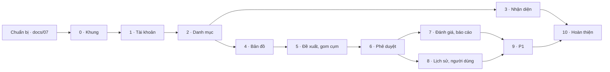

# Thiết kế triển khai backend Signa

**Trạng thái:** Nháp, chờ duyệt · **Nhánh:** `hana200804/Backend` · **Cập nhật:** 2026-11-23

Tài liệu này không thay bộ thiết kế trong `docs/`. Nó mô tả **cách dựng** backend theo [Kiến trúc](../03-kien-truc.md), [CSDL](../06-co-so-du-lieu.md), [API](../07-api.md), [Thiết kế AI §6](../04-thiet-ke-ai.md#6-gom-cụm-và-điểm-tin-cậy), [Kiểm thử §2.2](../08-kiem-thu.md#22-backend) và ADR-0005 → ADR-0007. Mọi hành vi nghiệp vụ lấy từ các tài liệu đó; nếu có mâu thuẫn, tài liệu gốc đúng.

Những mục ghi **(đề xuất)** là lựa chọn của người viết, chưa được nhóm đồng ý.

## 1. Mục đích

Nhánh này hoàn thành backend Spring Boot của đề tài: tài khoản và phân quyền, danh mục biển, proxy nhận diện tới dịch vụ Python, bản đồ, đề xuất và gom cụm, phê duyệt, đánh giá, báo cáo, lịch sử xử lý.

Web quản trị (`web-admin/`, PR #32) đã có và đang chờ backend. Ứng dụng di động do cùng một thành viên làm. Vì vậy **hợp đồng API là ranh giới giữa hai người**. Backend lấy các kiểu dữ liệu web đang dùng làm bản nháp cho những phần `docs/07` còn bỏ trống, thay vì bắt web làm lại. Những điểm web cần sửa được ghi ở issue #33.

Thành công nghĩa là:

- Mọi endpoint trong `docs/07` §3–§8 chạy đúng hợp đồng, kể cả định dạng lỗi §2.
- Web quản trị ở chế độ `api` chạy được với backend thật, không phải sửa kiểu dữ liệu.
- Các ca UT-B01 → UT-B12 và IT-B01 → IT-B14 đạt, chạy tự động trên CI.
- `docker compose up` dựng đủ hệ thống; độ phủ ≥ 90% cho gom cụm, điểm tin cậy, gợi ý và ≥ 70% cho phần còn lại.

## 2. Phạm vi

| Nhóm | Yêu cầu |
| --- | --- |
| P0 | FR-01, FR-02, FR-04 → FR-10, FR-20 → FR-24 (phía backend), FR-30 → FR-36; NFR-03, NFR-04, NFR-09 → NFR-11, NFR-13 |
| P1 | FR-11, FR-13, FR-25, FR-37, FR-38. Web đã có màn hình FR-37, FR-38 nên hai mục này nên làm |
| Hạ tầng | Dockerfile backend, Docker Compose, nginx gateway, workflow CI `backend.yml` |

**Ngoài phạm vi:**

- Web quản trị và ứng dụng di động.
- Dịch vụ nhận diện Python: đã có trong `ai/service`, backend chỉ gọi.
- FR-14 (tìm địa điểm): chờ Q6, chỉ dựng interface và bản cài đặt giả.
- FR-15, FR-16: chạy trên điện thoại.
- Các hướng mở rộng còn chờ quyết định trong `CLAUDE.md`.

**Những điều làm hỏng kết quả dù code vẫn chạy:**

- Gom cụm tạo biển trùng khi nhiều đề xuất đến cùng lúc (IT-B03).
- Một thay đổi trạng thái, mã hoặc vị trí của biển thiếu dòng `audit_logs` trong cùng giao dịch (NFR-11).
- Ảnh gửi để nhận diện bị ghi xuống đĩa hoặc MinIO (NFR-09).
- Một endpoint quản trị thiếu kiểm tra quyền.
- Module đọc thẳng bảng của module khác.
- Công thức điểm hoặc thứ tự luật gom cụm lệch với `docs/04 §6`, làm số liệu đánh giá G4 mất giá trị.

## 3. Ràng buộc

- Máy có Java 21, chưa có Gradle và Docker. Dùng Gradle wrapper. Chưa có Docker thì test Testcontainers và `docker compose` chạy trên GitHub Actions, unit test chạy trên máy.
- MySQL 8, Redis 7, MinIO theo đề tài. Lược đồ theo `docs/06`, migration ở `backend/src/main/resources/db/migration`.
- Danh mục nhãn lấy từ `ai/data/labels.yaml` v1, 46 lớp.
- Hợp đồng dịch vụ nhận diện theo mã thật trong `ai/service/app.py`: `POST /v1/detect`, `GET /v1/models`, `GET /healthz`. Lỗi `503` kèm `Retry-After`.
- Hợp đồng với web theo các kiểu trong `web-admin/src/*Types.ts` và `web-admin/src/reviewApi.ts`, được ghi lại vào `docs/07`.
- Đóng băng tính năng cuối tuần 12. Thứ tự cắt khi chậm: FR-25 → FR-14 → FR-37, FR-38. Không cắt FR-31.

## 4. Phương án đã cân nhắc

Cách chia module, CSDL và hạ tầng đã được ADR chốt. Câu hỏi còn lại là **thứ tự dựng**.

| Phương án | Cách làm | Được | Mất |
| --- | --- | --- | --- |
| A · Theo lớp | Viết hết migration và entity, rồi service, cuối cùng controller | Lược đồ ổn định sớm | Gần cuối mới có endpoint chạy được; web và di động phải chờ |
| B · Khung API trước | Dựng mọi endpoint trả dữ liệu giả, rồi thay dần bằng logic thật | Hợp đồng có ngay | Mỗi endpoint làm hai lần; dữ liệu giả dễ lệch hành vi thật. Web đã có chế độ `demo` làm việc này |
| **C · Lát dọc theo luồng nghiệp vụ** | Mỗi lát gồm migration, logic, API và test của một nhóm FR | Mỗi lát nghiệm thu bằng ca kiểm thử trong `docs/08` và web dùng được ngay | Lát đầu nặng vì phải dựng khung |

**Chọn C (đề xuất).** Để bù điểm yếu của C: hợp đồng API được chốt trước lát 0 (§6, bước chuẩn bị), lát 0 tạo trọn lược đồ, và có dữ liệu mẫu từ lát 2 để web và di động thử bản đồ trước khi gom cụm xong.

## 5. Quyết định kỹ thuật

### 5.1. Công cụ

| Hạng mục | Lựa chọn | Lý do |
| --- | --- | --- |
| Build | Gradle Kotlin DSL kèm wrapper, trong `backend/` | ADR-0005; chạy được trên máy chưa cài Gradle |
| Framework | Spring Boot GA mới nhất mà springdoc, Testcontainers, ArchUnit đều hỗ trợ. Thử dòng 4.x trước, chưa được thì dùng 3.5.x. Ghi phiên bản đã chọn vào README | Không khoá vào phiên bản chưa kiểm tra |
| Truy cập dữ liệu | **(đề xuất)** `JdbcClient` cùng SQL viết tay, không dùng JPA | Lược đồ dùng `POINT SRID 4326` với `axis-order=long-lat` và khoá lạc quan `WHERE version = ?`. SQL tường minh khớp từng câu trong `docs/06 §9` và tránh lỗi trục toạ độ của Hibernate Spatial |
| Migration | Flyway, chạy bằng tài khoản CSDL riêng | Tài khoản ứng dụng chỉ có `SELECT, INSERT` trên `audit_logs` |
| Bảo mật | Spring Security, filter token phiên tự viết, `@PreAuthorize("hasAuthority('…')")` | `docs/03 §6.6`: token ngẫu nhiên 256 bit trong Redis, kiểm tra theo quyền |
| Redis | Spring Data Redis (Lettuce) | Phiên, giới hạn tần suất, OTP, cache, stream |
| MinIO | MinIO Java SDK | Ba bucket, URL ký 10 phút |
| Gọi dịch vụ nhận diện | `RestClient`, timeout kết nối 1 s, đọc 5 s | IT-B08 |
| Ảnh | `ImageIO` cùng TwelveMonkeys cho WebP; nhận dạng định dạng bằng magic bytes | `415` khi đuôi file giả |
| Tài liệu API | springdoc tại `/api/v1/openapi.json`; Swagger UI chỉ bật ở profile `local` | `docs/07 §9` |
| Kiểm thử | JUnit 5, AssertJ, Testcontainers, WireMock, RestAssured, ArchUnit, JaCoCo | `docs/08 §1` |
| Log, metric | Log JSON một dòng có `requestId`, `userId`, không ghi mật khẩu hay token. Micrometer qua `/actuator/prometheus`, chỉ mở trong mạng nội bộ | `docs/03 §9`, `docs/08 §7` |

Web dev server chuyển tiếp `/api/v1` qua proxy của Vite (`SIGNA_TARGET`), bản demo đi qua nginx cùng origin. Vì vậy backend **không bật CORS**.

### 5.2. Cấu trúc mã

```text
backend/
├── build.gradle.kts, settings.gradle.kts, gradlew
├── Dockerfile
└── src/
    ├── main/java/vn/signa/
    │   ├── shared/        # lỗi chung, requestId, phân trang, toạ độ, Clock, cấu hình
    │   ├── identity/      # api/ · internal/ · web/
    │   ├── catalog/
    │   ├── recognition/
    │   ├── sign/          # gồm clustering/ (logic thuần) và worker/
    │   └── audit/
    ├── main/resources/db/migration/   # V1__… .sql, R__demo_data.sql
    └── test/java/vn/signa/            # unit, tích hợp, kiến trúc, mô phỏng docs/08 §6
infra/
├── compose.yaml, .env.example
├── mysql/init/01-users.sql            # tài khoản signa_migrator và signa_app
└── nginx/default.conf
```

- Gói `api` của mỗi module chứa interface và DTO công khai; `internal` và `web` là riêng tư.
- ArchUnit kiểm tra rằng code ngoài module chỉ dùng gói `api`, và không có chu trình phụ thuộc.
- ArchUnit không thấy tên bảng trong chuỗi SQL. Vì vậy có thêm một test quét các hằng SQL trong `internal` của từng module, báo lỗi khi gặp bảng không thuộc module đó theo `docs/03 §5`. Riêng `audit_logs` chỉ được ghi qua `audit.api`.
- Logic gom cụm, trọng số, điểm Beta, gợi ý và chuyển trạng thái nằm trong `sign/clustering` dưới dạng Java thuần, không phụ thuộc Spring.
- `audit.api.AuditRecorder` được gọi trong giao dịch của module gây ra thay đổi. Các module dùng chung một `DataSource` nên lịch sử và thay đổi cùng commit (NFR-11).
- Tên gói gốc `vn.signa` **(đề xuất)**.

### 5.3. Điểm cài đặt cần chú ý

| Chủ đề | Cách làm |
| --- | --- |
| Định dạng lỗi | Một `@RestControllerAdvice` ánh xạ ngoại lệ sang bảng mã `docs/07 §2`. `429` có `Retry-After`. Mọi lỗi mang `requestId` |
| `X-Request-Id` | Nhận từ nginx hoặc tự sinh; đưa vào MDC, response, lời gọi dịch vụ nhận diện và `audit_logs.request_id` |
| Phiên | `session:{token}`, `user-sessions:{userId}` theo `docs/06 §10`. Đổi mật khẩu, khoá tài khoản hoặc đổi vai trò thì xoá các phiên của người đó |
| Đăng nhập web | `client = WEB` mà tài khoản không có `review:decide` thì trả `403` (FR-30). Sai quá 10 lần trong 15 phút theo email và IP thì `429` |
| Giới hạn tần suất | Cửa sổ cố định bằng `INCR` cùng `EXPIRE`. Nhận diện: 10/phút mỗi người dùng, 30/phút mỗi IP khách. OTP: tối đa 3 lần gửi mỗi 15 phút cho mỗi email và IP **(đề xuất)**, tối đa 5 lần nhập sai theo FR-13 |
| Nhận diện | Kiểm tra định dạng và ≤ 10 MB rồi giải mã trong bộ nhớ. Thu cạnh dài về 1280 px, gọi `/v1/detect`, quy đổi box về kích thước gốc, thêm tên, ý nghĩa, `iconUrl`. Không ghi ảnh ra đâu (IT-B09). Lỗi `503` hoặc timeout thì trả `503 RECOGNITION_UNAVAILABLE` |
| Bản đồ | `LIMIT 501` theo `docs/06 §9`. Được 501 dòng thì gom theo ô lưới cạnh `360 / 2^zoom / 8` độ trên toàn vùng, để tổng số đếm đúng (IT-B07) |
| Gửi đề xuất | Kiểm tra `labelMapVersion` và ảnh cắt ≤ 200 KB, ghi `sign-crops/{newId}.jpg`, rồi `INSERT`. Vi phạm `UNIQUE(user_id, client_id)` thì đọc bản ghi thắng, xoá ảnh vừa ghi, trả `200` (IT-B14). Commit xong mới `XADD`; lỗi Redis vẫn trả `201` |
| Worker gom cụm | Một consumer `clustering`. Mỗi mục: `SELECT … FOR UPDATE` đề xuất, bỏ qua nếu đã khác `RECEIVED`, chạy luật `docs/04 §6`, cập nhật biển, trọng số, đề xuất, lịch sử trong một giao dịch, rồi `XACK` và `XDEL`. Khi khởi động đọc lại mục còn treo; định kỳ quét đề xuất `RECEIVED` cũ hơn 1 phút (ADR-0007). Bật bằng `signa.clustering.worker.enabled` |
| Vị trí và hướng | Vị trí là trung vị có trọng số theo `w`, tính riêng cho vĩ độ và kinh độ của các đề xuất mang mã dẫn đầu; bỏ qua khi `location_locked`. Lệch hướng là `min(d, 360 − d)` với `d` là trị tuyệt đối của hiệu hai hướng, so với 45° |
| Phê duyệt | `UPDATE signs … WHERE id = ? AND version = ?`; 0 dòng thì `409 SIGN_ALREADY_PROCESSED`. Cùng giao dịch: cập nhật đề xuất thành viên và ghi lịch sử. Worker cũng tăng `version` khi bằng chứng đổi |
| Giữ kèm sửa | `POST /admin/signs/{id}/keep` nhận thêm `signTypeCode`, `location`, `headingDeg` tuỳ chọn. Sửa và giữ nằm trong một giao dịch, ghi hai dòng lịch sử `EDITED` và `KEPT`. Web chỉ gọi một lần (issue #33) |
| Lịch sử bất biến | `infra/mysql/init/01-users.sql` tạo `signa_migrator` (DDL) và `signa_app` (`SELECT, INSERT` trên `audit_logs`). Compose và Testcontainers dùng **chung** script này. IT-B05 thử `UPDATE`/`DELETE` bằng `signa_app` và phải bị từ chối |
| Danh mục nhãn | Lệnh `import-labels` đọc `SIGNA_LABELS_PATH`, upsert `sign_categories` và `sign_types`, đổi khoá nhóm sang chữ hoa (`prohibitory` → `PROHIBITORY`), xoá `cache:sign-types`. ETag là hash nội dung |
| Quản trị viên đầu tiên | **(đề xuất)** Chưa có `ADMIN` thì khởi động tạo một tài khoản từ `SIGNA_BOOTSTRAP_ADMIN_EMAIL` và `SIGNA_BOOTSTRAP_ADMIN_PASSWORD`, ghi lịch sử với `actor_type = SYSTEM`. Thiếu biến thì bỏ qua. Không có mật khẩu mặc định |
| Dọn ảnh | Job định kỳ: xoá ảnh `sign-crops` của biển `REJECTED` sau 90 ngày, ảnh `report-photos` 90 ngày sau khi báo cáo được xử lý (`docs/06 §11`). Xoá ảnh trong `sign-crops` không có bản ghi MySQL và cũ hơn 1 giờ (ADR-0006) |
| Metric | Độ dài stream, số mục chưa `XACK`, số đề xuất `RECEIVED` và tuổi đề xuất chờ lâu nhất (ADR-0007); thời gian gọi dịch vụ nhận diện theo mô hình |
| Thời gian | Inject `Clock` để test luật 12 giờ, 30 ngày và 90 ngày |

## 6. Các bước triển khai

**Bước chuẩn bị** (trên `hana200804/Backend`, trước lát 0): bổ sung vào `docs/07` các schema web quản trị đang dùng và các endpoint còn thiếu. Gồm chi tiết và hàng đợi phê duyệt, `keep` kèm sửa, gỡ biển kèm `version`, báo cáo gom theo biển, danh mục quản trị gồm cả loại ngừng dùng, so sánh mô hình, thống kê, và kích thước ô lưới. Bạn làm web đọc lại trong PR này.

Mỗi lát xong khi các ca kiểm thử liệt kê đạt trên CI, OpenAPI khớp `docs/07`, và `markdownlint` sạch.

| Lát | Nội dung | Yêu cầu | Ca kiểm thử nghiệm thu | Cỡ |
| --- | --- | --- | --- | --- |
| 0 · Khung | Gradle, 5 module cùng `shared`, test kiến trúc, xử lý lỗi, requestId, log, springdoc. Flyway `V1` gồm **toàn bộ** lược đồ và dữ liệu vai trò, quyền. `infra/compose.yaml` cho MySQL, Redis, MinIO kèm script tài khoản. Workflow `backend.yml` | NFR-13 | Test kiến trúc; ứng dụng khởi động trên Testcontainers; `/actuator/health` | Lớn |
| 1 · Tài khoản | Đăng ký, đăng nhập, đăng xuất, `/me`, đổi mật khẩu, filter phiên, ma trận quyền, giới hạn đăng nhập. Dockerfile và backend trong Compose để web gọi được API thật | FR-01, FR-30, NFR-10 | IT-B10, UT-B11 (mở rộng ở mỗi lát sau) | Vừa |
| 2 · Danh mục | `import-labels`, `GET /sign-categories`, `/sign-types` có ETag, quản trị danh mục và ảnh minh hoạ. `R__demo_data.sql` với biển mẫu cho profile `demo` | FR-08, FR-35 | `304` với `If-None-Match`; không xoá loại đang dùng; web trang danh mục chạy với API thật | Vừa |
| 3 · Nhận diện | `GET /recognition/models`, `POST /recognition/detect`, giới hạn tần suất, thu nhỏ ảnh, quy đổi box | FR-02, FR-24 | IT-B08, IT-B09, IT-B13 trên WireMock | Nhỏ |
| 4 · Bản đồ | `GET /signs` (bbox, lọc, gom ô), `GET /signs/{id}` với URL ký ảnh đại diện | FR-05 → FR-07 | IT-B06, IT-B07 trên dữ liệu mẫu; `404` với biển chưa công bố | Nhỏ |
| 5 · Đề xuất và gom cụm | `POST /submissions`, `sign-crops`, stream, worker, trọng số, điểm, gợi ý, vị trí, job dọn ảnh, metric hàng đợi | FR-04, FR-20, FR-21 | UT-B01 → UT-B07, UT-B12; IT-B01 → IT-B03, IT-B12, IT-B14 | Lớn nhất |
| 6 · Phê duyệt và sửa biển | Hàng đợi, chi tiết, duyệt, từ chối, giữ (kèm sửa); thêm, sửa, gỡ trực tiếp | FR-23, FR-31, FR-33 | IT-B04, IT-B05; web duyệt được một biển | Lớn |
| 7 · Đánh giá và báo cáo | Đánh giá, báo cáo kèm ảnh, rà soát lại, xử lý báo cáo, `GET /me/reports` | FR-09, FR-10, FR-22, FR-32 | UT-B08, IT-B11; người gửi tự đánh giá thì `422` | Vừa |
| 8 · Lịch sử và người dùng | `GET /admin/audit-logs`, quản lý người dùng | FR-34, FR-36 | Ma trận UT-B11 đầy đủ; khoá tài khoản thì mất phiên | Nhỏ |
| 9 · P1 | `GET /me/submissions`, OTP (Mailpit khi dev), tự duyệt (mặc định tắt), so sánh 3 mô hình, thống kê, interface tìm địa điểm | FR-11, FR-13, FR-25, FR-37, FR-38 | UT-B09, UT-B10; test API từng mục | Vừa |
| 10 · Hoàn thiện | Compose đầy đủ gồm nginx và dịch vụ nhận diện, k6, script mô phỏng `docs/08 §6`, checklist bảo mật | NFR-03, NFR-04 | Checklist `docs/08 §7`; k6 `docs/08 §8` | Vừa |

Lát 0–6 là P0 cốt lõi và phải xong trước tuần 11 để kịp luồng đầu–cuối. Nếu chậm, lát 9 cắt theo thứ tự ở §3. Lát 10 làm song song với thử nghiệm thực địa.



## 7. Kiểm thử và xác minh

- Unit test cho `sign/clustering` và các validator chạy trên máy, không cần Docker.
- Test tích hợp dùng một bộ Testcontainers chung (MySQL 8 với script `infra/mysql/init`, Redis 7, MinIO), khởi động một lần cho cả suite. Dịch vụ nhận diện giả lập bằng WireMock theo schema trong `ai/service/app.py`.
- IT-B03 gửi song song 20 đề xuất rồi chờ worker xử lý hết. IT-B12 dừng Redis giữa chừng.
- JaCoCo: ngưỡng 90% cho `vn.signa.sign.clustering`, 70% cho toàn bộ; CI fail khi dưới ngưỡng.
- `backend.yml` chạy khi PR đụng `backend/**` hoặc `infra/**`: build, kiểm tra định dạng, test, JaCoCo, gitleaks.
- Chưa có Docker trên máy thì kết quả test tích hợp lấy từ CI; mỗi PR ghi rõ test nào chạy ở đâu.

## 8. Quy trình Git

`hana200804/Backend` là nhánh cha, giữ tài liệu thiết kế và bước chuẩn bị. Mỗi lát có một worktree Orca con, nhánh tách từ `main`:

| Lát | Nhánh | Worktree |
| --- | --- | --- |
| 0 | `backend/0-scaffold` | `BE-00-Khung` |
| 1 | `backend/1-identity` | `BE-01-Tài-khoản` |
| 2 | `backend/2-catalog` | `BE-02-Danh-mục` |
| 3 | `backend/3-recognition` | `BE-03-Nhận-diện` |
| 4 | `backend/4-map` | `BE-04-Bản-đồ` |
| 5 | `backend/5-submissions-clustering` | `BE-05-Đề-xuất-gom-cụm` |
| 6 | `backend/6-review` | `BE-06-Phê-duyệt` |
| 7 | `backend/7-ratings-reports` | `BE-07-Đánh-giá-báo-cáo` |
| 8 | `backend/8-audit-users` | `BE-08-Lịch-sử-người-dùng` |
| 9 | `backend/9-p1` | `BE-09-P1` |
| 10 | `backend/10-hardening` | `BE-10-Hoàn-thiện` |

- Trước khi bắt đầu một lát, merge `main` mới nhất vào nhánh của lát đó.
- Mỗi lát lặp lại một vòng: viết kế hoạch chi tiết cho riêng lát, viết test trước rồi tới mã, chạy unit test trên máy, push để CI chạy test tích hợp, review, rồi PR vào `main`. Mỗi PR có ít nhất một người review trước khi merge.
- Thay đổi hợp đồng API cập nhật trong `docs/07` cùng PR. Đổi quyết định trong ADR thì viết ADR mới.
- Sau mỗi lát, báo bạn làm web và di động những endpoint đã dùng được.

## 9. Những thứ còn thiếu

| Còn thiếu | Chặn từ | Trong lúc chờ |
| --- | --- | --- |
| Tên và email cho git | Ngay bây giờ | Không có cách thay |
| Quyền push để CI chạy | Lát 0 | Chỉ chạy được unit test trên máy |
| Docker trên máy | Lát 10 | CI chạy test tích hợp |
| Bạn làm web đọc lại `docs/07` | Lát 6 | Lát 0–5 theo các endpoint đã định nghĩa |
| Nhóm duyệt các ADR (issue #1) | Không chặn | Làm theo bản `Proposed` |
| SMTP cho FR-13 | Lát 9 | Mailpit |
| Nhà cung cấp tìm địa điểm (Q6) | Lát 9 | Interface và bản giả |
| Server tham chiếu (Q7) | Đo NFR-02 → NFR-04 | Không ảnh hưởng việc viết mã |
| Ý nghĩa biển theo QCVN 41 (`labels.yaml` chưa có trường này) | Demo | `description = NULL`, quản trị viên điền qua FR-35 |
| Ảnh minh hoạ (mới có 12/46 mã) | Demo | `iconUrl = null` |
| Phân công thực tế trong `docs/01 §7` và `docs/09` | Không chặn | Cập nhật khi nhóm chốt ai làm gì |

## 10. Để người triển khai tự quyết

Tên lớp, cách chia service bên trong module, cách đặt tên test, chi tiết cấu hình Gradle, mức log, cách tổ chức fixture test. Mọi lựa chọn phải giữ quy tắc ranh giới module và các ca kiểm thử ở §6.
