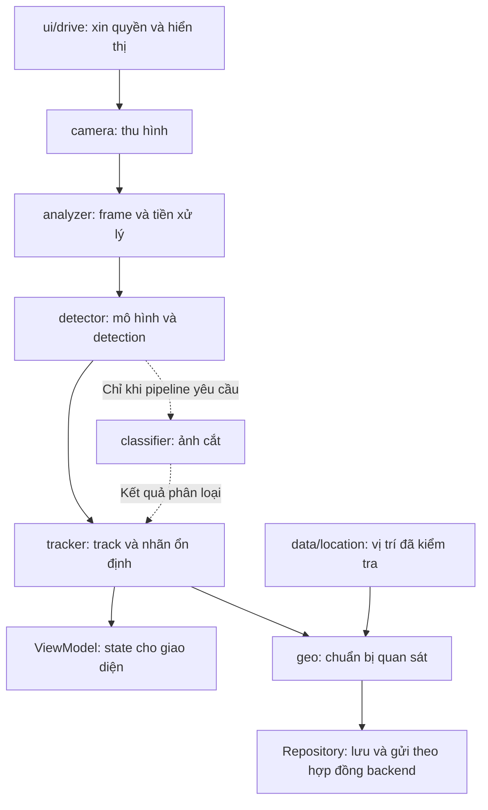

# Vision: camera và nhận diện trên điện thoại

## Cấu trúc đã chia

```text
vision/
├── README.md
├── camera/        # Thu hình, vòng đời và trạng thái CameraX
├── analyzer/      # Nhận frame và chuẩn bị ảnh cho mô hình
├── detector/      # Chạy TFLite và giải mã detection
├── classifier/    # Phân loại ảnh cắt nếu pipeline cần
├── tracker/       # Theo dõi biển qua nhiều frame, ổn định nhãn
└── geo/           # Kết hợp track với vị trí để chuẩn bị quan sát
```

Các package đều có README mô tả trách nhiệm và file dự kiến. README giữ thư mục trong Git thay cho .gitkeep; không tạo class rỗng để khiến khung trông như đã triển khai.

## Luồng dự kiến và điểm nối bên ngoài



Đây là sơ đồ hướng kết nối cho giai đoạn tiếp theo, chưa phải các lời gọi hiện có. ViewModel/điều phối sẽ nối các thành phần; camera không trực tiếp sở hữu detector, tracker hoặc repository backend.

## Trạng thái hiện tại

| Phần | Trạng thái |
| --- | --- |
| camera | Đã có CameraPreviewSession.kt và CameraPreviewStatus.kt |
| analyzer | Chờ tích hợp luồng frame |
| detector | Chờ mô hình và implementation TFLite |
| classifier | Giữ khung; chưa cần trong pipeline YOLO trực tiếp mã biển |
| tracker | Chờ triển khai theo dõi/ổn định biển |
| geo | Chờ hợp đồng quan sát và gắn vị trí |

CameraPreview.kt ở ui/drive/components là adapter hiển thị camera thật, không phải màn thiết kế mẫu. Giữ adapter này ở UI; phần xử lý thiết bị nằm trong camera.

## Quy tắc ranh giới

- Model kết quả dùng chung giữa vision, UI và repository phải thống nhất ở domain khi triển khai, không truyền ImageProxy/tensor/DTO HTTP xuyên các tầng.
- analyzer chịu trách nhiệm tuổi thọ frame; detector quản lý runtime mô hình; tracker quản lý tuổi thọ track.
- Dùng mã biển và phiên bản nhãn theo nguồn AI hiện hành. Không tự tạo bảng nhãn thứ hai trong Android.
- geo nhận vị trí đầu vào, không tự xin quyền GPS hoặc gửi mạng. UI không chạy mô hình hoặc xử lý ảnh.
- Không đưa cảnh báo/TTS hoặc Retrofit vào vision. Không tự đổi phạm vi P0/P2 của dự án khi nối pipeline.
- Các file được ghi là dự kiến trong README từng package chỉ tạo khi thực sự triển khai chức năng đó.

Đối chiếu với [kiến trúc Android](../../../../../../../../ARCHITECTURE.md) và tài liệu AI ở gốc dự án trước khi triển khai. Nếu IDE gộp tên vision.camera, xem cây thư mục ở chế độ Project để phân biệt cách hiển thị package với cấu trúc trên ổ đĩa.
