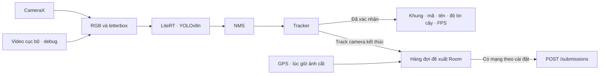

# Vision · Nhận diện biển trên điện thoại

## Trạng thái hiện tại

| Package | Trạng thái |
| --- | --- |
| [camera](camera/) | CameraX chạy Preview và ImageAnalysis cùng ViewPort, nhả tài nguyên theo vòng đời. |
| [analyzer](analyzer/) | Nhận khung mới nhất, chuyển sang RGB, xoay, letterbox và chạy chuỗi xử lý. |
| [detector](detector/) | YOLOv8n 640 FP16 đóng gói sẵn, chạy bằng LiteRT CPU XNNPACK, NMS theo lớp. |
| [classifier](classifier/) | Dành cho mô hình phân loại riêng nếu thiết kế thay đổi. |
| [tracker](tracker/) | Xác nhận 3/5 khung, bỏ phiếu nhãn, giữ ảnh cắt theo từng mã và kết thúc track. |
| [geo](geo/) | Gắn GPS và hướng với khung giữ ảnh cắt. ViewModel chuyển đề xuất cho hàng đợi Room hiện có. |
| [replay](replay/) | Bản debug phát lại video cục bộ qua cùng pipeline và ghi thống kê Logcat. |

## Luồng xử lý

`vision` giữ pipeline ngoài luồng UI. Adapter Compose chiếu tọa độ phân tích sang PreviewView. `data/location` cung cấp vị trí và ViewModel dùng hàng đợi đề xuất của lát ảnh. Mô hình camera đọc danh mục nhúng cùng mô hình, nên khách và thiết bị mất mạng vẫn dùng được nhận diện.

Xem [cách chạy và đối chiếu](../../../../../../../../CAMERA_SETUP.md) và [kiến trúc Android](../../../../../../../../ARCHITECTURE.md).
